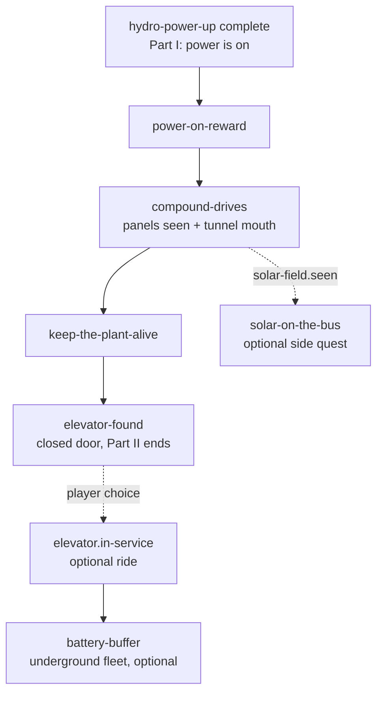
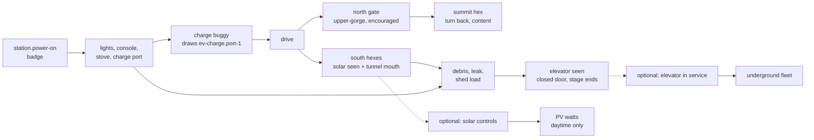

# Part II Daily Operations, Through the Elevator

| | |
| --- | --- |
| **Author** | Dave and Grok |
| **Date** | 2026-11-19 |
| **Status** | Draft |
| **Audience** | Story authors and engineers working in `game/` |
| **Product authority** | The plot stated for this stage, including the 2026-11-19 decisions: Part II is Daily Operations and ends when the elevator is discovered; solar and the battery fleet are optional side quests inside that part. Where older design docs disagree, this document says so and follows that plot. |
| **Implementation authority** | `game/content/atomic-adventures.sqlite`, then current code, then `docs/contracts/`. Tests are not content truth. |

This is an engineering plan for authoring and the gaps underneath it. It is not scene prose.

---

## Overview

The playable Story path brings Zanzibar through the fence, into the utility station, and up to the moment Clearwater Diversion is connected. The story-arc document then stops. `hydro-power-up` has `completion: null` and its last beat has `next: null`. A finished save stays in Story mode in the control room with `story.activeBeatId === null`. Lights, the operational console, a one-shot EV plug, and a one-shot stove flag already exist in pieces. Nothing charges a real buggy battery, nothing drives, the south side of the fenced compound is not on the hex map, and generation versus the four coarse loads does not yet force a brownout.

Part I is the playable story already in the database, through turning Clearwater Diversion on. This document is **Part II, Daily Operations**: the player gets familiar with the hydro system, explores the fenced compound, and keeps surviving. It ends when Zanzi **discovers** the elevator to the underground area where the Gen IV SMR is. Discovering the closed door finishes the required stage. Operating the reactor stays out of scope.

Power-on is a milestone with a badge. That sitting unlocks the control panel (already wired), lights (already wired), kitchen appliances (only a flag today), and — immediately — charging and driving the buggy. The charged buggy covers the whole fenced compound. The unmapped south is where he sees the solar panels and, separately, a tunnel entrance. Those two sights are required. Connecting the panels is not. An encouraged drive leaves by the north gate for the scenic overlook; the road toward the summit tells him to turn back and recharge. That boundary is authored content on the last mapped hex, not a new movement model, and it does not gate the south discoveries. Between drives he eats, drinks, sleeps, reads holo-lessons, clears intake debris, patches pipe leaks, and lives with a local bus that cannot run every load at once.

Solar and the battery fleet are optional side quests inside Daily Operations. Skipping either one still finishes the stage. Neither gates `elevator-found`. The solar quest unlocks once the panels have been seen: the player may learn whether they work and how to connect them to the local grid, or leave them dark. The battery fleet is below ground, out of the elements, and becomes discoverable only after a later, optional beat puts the elevator in service. That ride is not Part III. The concrete designs for both quests are in [Solar and battery side quests](#6-solar-and-battery-side-quests) so they can be built.

---

## Background & Motivation

### What the July 2026 note said, and what the database says

A July 2026 note described the chain `part-i-opener` → `part-i-station` → `understand-building`, ending at hydro online, plus an alternate `part-i-fence-hole`. **That note is stale.** `story_arc_documents.id = story-main` (version 28, updated 2026-08-16) contains four arcs and nothing after startup:

| Arc id | Title | Start beat | Completion |
| --- | --- | --- | --- |
| `lost-in-forest` | Lost in the Forest | `survive-in-the-woods` | `nextArc: means-of-survival` |
| `crawl-under-fence` | Enter From Under the Fence | `approach-side-entrance` | `nextArc: means-of-survival`, `nextBeat: look-for-shelter` |
| `means-of-survival` | Find Means of Survival | `look-for-shelter` | `nextArc: hydro-power-up` |
| `hydro-power-up` | Engage Hydro Power | `understand-building` | **`null`** |

`hydro-power-up` beats, in order: `understand-building` → `inspect-intake` → `clear-open-intake` → `align-diversion-valve` → `open-turbine-valve` → `return-control-room` → `connect-power` → `check-console` → `complete-startup`. `complete-startup.completesWhen` is `facility.hydro.startupComplete === true` and `next` is null.

`useStoryArc` (`game/src/composables/useStoryArc.js`) still contains `recoverBranchToFenceHoleArc()`, which looks up `part-i-fence-hole` and `part-i-opener` only. Neither id is in the document, so that branch is a no-op. `crawl-under-fence` is in `story-main` (start beat `approach-side-entrance`, `nextArc` `means-of-survival`, `nextBeat` `look-for-shelter`) and nowhere in `game/src` or `game/server` except as that document. Hole crossings set `compound.fence-hole-passed` and do not change `activeArcId`. `find-a-way-past-fence` completes only on `compound.gate-passed`. A hole-only save does not enter `crawl-under-fence` and does not finish Part I, so Part II resume does not handle that arc id. Leave `recoverBranchToFenceHoleArc` alone.

`createStoryState` still defaults `activeArcId` to `STORY_ARC_ID = "part-i-opener"` in `useGameState.js`. `activeArc` falls back to the first `defaultMode: "story"` arc when the saved id matches nothing, which is `lost-in-forest`. `ensureStarted` rebuilds story state onto that arc when `activeArcId` itself is missing from the document. An unknown **beat** id on an arc that still exists does not do that: the beat stays unresolved and `storyError` names it. Do not copy the dead ids into new content.

`game/server/story-arc-seed.js` still seeds the July chain. `StoryArcRepository.ensureSeed` (`story-arc-repository.js`) runs it only when `story-main` is absent, via `content-repositories.js`. The live database already has a document, so the seed is not what players are on. Authors edit `story-main` in SQLite. Do not treat the seed as a second source of arcs.

There is no authored beat whose trigger is “hydro is online, now what?” `story_areas.part-i.milestones_json` lists only `library.sleep-1`, `day-2.started`, and `gate-unlocked`.

### Where older design docs disagree with this plot

These docs are useful for systems and names. They are **not** the plot for this stage.

| Older text | What it says | What this stage does instead |
| --- | --- | --- |
| `game-design/content/story/story-overview.md`, `part-i-unlocks.md`, `docs/tech-roadmap.md` | Part I ends when Zanzibar is a qualified hydro operator. Solar is seen on an eBuggy tour but stays dormant until that gate. The hidden elevator is the Part II → Part III threshold after PV restoration. | Part I here is the story through turning the power on. Part II is Daily Operations and ends when the elevator is **discovered**. Buggy charge and driving land **with** the power-on milestone. Solar **sighting** is the south drive, not a reward for rank 3. Operator qualification (`hydro-operations` rank 3) may keep accruing; it does not gate these arcs. Operating the SMR is out of scope. |
| `game-design/content/subject-matter/photovoltaic-simulation.md` | Part II is a PV sandbox: layout, tilt, shading, I-V, MPPT, inverter sizing. | Part II is Daily Operations. The solar side quest is a disconnect, an inverter, and daytime watts on the existing bus, and the player may skip it. The placement sandbox stays out of this stage. |
| `part-i-unlocks.md` discovery table | Battery array, solar field, and reactor tease are one compound tour. | Solar panels and the **tunnel entrance** are two required discoveries on the south drive. The elevator is a later required beat: a closed door. The battery fleet is underground, after the elevator is optionally put in service, and using it is optional. |

`game-design/content/story/regional-geography.md` and the hydro contract stay authoritative for **names**: Clearwater Run (stream), Clearwater Diversion (plant), Clearwater Station (utility building and its bus). The building document id remains `utility-station`. Those proper names are supposed to be discovery-gated. The locked operational-console chrome already titles screen 2 **Clearwater Station grid** (`docs/contracts/control-panel.md`). This plan does not reopen that lock. New beats should give Zanzi an in-world source (plaque, binder, or the console he already opened) rather than inventing a second name.

### Pain

- Finished players have nowhere to go in the story. `useStoryArc.tick` returns when `activeBeat` is null. `ensureStarted()` will not adopt a successor just because `hydro-power-up.completion.nextArc` is filled in **after** the arc was already marked complete.
- The celebration the plot asks for is half-built: power really does energize the bus, but the reward is not a beat, not a badge, and not a drive.
- The south the plot depends on is not in `outdoor-main`. Authors cannot place solar or a tunnel on a hex that does not exist.
- The grid lesson the plot depends on does not happen with today’s ratings. Healthy Clearwater Diversion is a few kilowatts above the sum of the four coarse loads, so “everything on” is not a brownout. See [Local grid and brownouts](#local-grid-and-brownouts).

---

## Goals & Non-Goals

### Goals

1. Chain four required arcs from the power-on sitting through elevator discovery, one shippable arc at a time. The required path merges without the optional side quests.
2. Make power-on a recorded milestone plus a visible badge, and put the buggy charge in that same arc.
3. Let a charged buggy drive the fenced compound, including new southern hexes. The existing north road to the scenic overlook is an encouraged excursion on that same charge budget.
4. Teach the two south discoveries as two ambient scenes on different hexes. One arc beat, `drive-south`, completes on flag `compound.drives-complete`, which the second discovery sets. Keep solar controls off those scenes. Keep both discoveries distinct from the elevator.
5. Author the summit turn-back as content on the last mapped road hex. Finishing `compound-drives` does not wait on it.
6. Make everyday play real on systems that already exist: eat, drink, sleep, holo-reader, intake debris, penstock leak, bus balance. Extend those systems; do not add a second plant model or a second story engine.
7. Ship a concrete optional solar quest (controls, daytime bus contribution, zero at night) that unlocks once the panels have been seen, and a concrete optional battery quest (underground fleet, surplus and bursts) that unlocks only once the elevator is in service.
8. Keep saves that have already finished `hydro-power-up` able to continue. Finishing `elevator-found` must not auto-start a side quest.

### Non-goals

- Part III: SMR operation, party reunion, isotope-explorer, fusion, AP-1000. The optional ride ends at the battery rooms.
- Making the summit a destination. The road past the turn-back hex is not mapped in this stage.
- Granting `generation.limit-lifted`, or keeping every coarse load on all night. Daytime hydro plus the optional PV curve may cover the charger and the stove. The shortfall this stage keeps is the night bus (PV at 0) and a battery that empties. The milestone stays reserved and ungranted.
- A second story engine, a quest log rewrite, or open-world as a new-game mode. Side quests are a small progress map beside the one active arc, not a second engine.
- Accounts, Neon, or cloud saves.
- An eBuggy driving **simulator** (`kind: "ride"` in `docs/contracts/stage-views.md`, “not started” on `docs/tech-roadmap.md`). Driving here is hex travel plus a charge budget.
- The PV panel-placement sandbox in `photovoltaic-simulation.md`.
- A surface battery cabinet, and any version of solar or battery that gates `elevator-found`.
- Rewriting `lost-in-forest` / `crawl-under-fence` or fixing `recoverBranchToFenceHoleArc` (noted so nobody copies it; not this stage’s work).

---

## Proposed Design

### 1. End state of the current playable arc

After `connect-power`, the player is still inside `hydro-power-up`. The building action `connect-power` (`utility-station` actions, room `control-room`) requires flag `hydro.open-turbine-valve`, spends 15 minutes, sets flags `hydro.level-1-complete` and `hub.hydro_online`, completes the `restore-hydro` quest objective `connect-power`, and calls `applyHydroStartupAction`. That patch (`game/src/lib/simulations/hydro/startupActions.js`) sets **both** `facilities.hydro.online` and `facilities.hydro.startupComplete` in one step. The following beat `check-console` waits for flag `hydro.console-checked`, which `GameView.handleHoloReaderAction` sets only when the player chooses **View console** at stand `console` while station power is on. The console opens with `mode: "startup"`. Then `complete-startup` completes on the next `useStoryArc` tick because `startupComplete` is already true. `onComplete` of that beat is null, so nothing grants a milestone.

**Observed end state** (a save that has just finished the arc, not a new game):

| Field | Value |
| --- | --- |
| **Play mode** | `"story"`. There is no mode change at the end of the arc. Open-world is not selected by the title screen (`docs/contracts/play-modes-and-story-mode.md`). |
| **Story** | `activeArcId: "hydro-power-up"`, `activeBeatId: null`, `completedArcIds` includes `hydro-power-up` and its predecessors, `completedBeatIds` includes `complete-startup`. No completion card, because `completion` is null. `storyError` is empty when the beat id is null (`useStoryArc`). |
| **Location** | Indoors, room `control-room`. The last movement restriction (`connect-power` and `check-console` use `current-location-only`) lifts on `complete-startup` (`movement.mode: "unrestricted"`), but the beat does not move the player. Story mode does not hard-block destinations: `isDestinationAllowed` in `storyActionAvailability.js` returns true. Guidance is prompts, not walls. |
| **Flags** | At least `hub.hydro_online`, `hydro.level-1-complete`, `hydro.console-checked`, the startup chain flags (`hydro.clear-intake-debris`, `hydro.open-intake`, `hydro.align-pipeflow`, `hydro.open-turbine-valve`), `library.sleep-1`, `day-2.started`, `day1.complete`, and either `compound.gate-passed` (canonical gate) or, if they used the hole, `compound.fence-hole-passed`. `hub.buggy-charged` is **not** set unless they already walked to the small bay and used `charge-ev`. |
| **Milestones** | `library.sleep-1` from the library sleep choice (`grant_milestones_json`). `day-2.started` is also written as a **flag** by that choice. No `hydro.online` milestone is recorded, despite the example in `docs/contracts/milestones.md`. |
| **Facility** | `facilities.hydro`: `online` true, `startupComplete` true, `intakeClear` true, `intakeOpen` true, both `manualValves` open, `debrisFraction` 0 (cleared by `clear-intake-debris`), `leakageFraction` 0 (initial value; nothing in play raises it). Indoor `facility.hydroOnline` mirrors host online via `useHydroFacility.syncStationPower`. `lightSwitches` default every room **open** (off) until the player closes one. |
| **Inventory** | Character `zanzibar-nuhero`. Starting holdings include the field backpack (Neutron bar, water bottle) and, in the kitchen, three Tastee Tack boxes of 14 meals each, glasses, and 8 purifier tablets. What remains depends on play. There is no buggy item. Building holder `vehicle:ebuggy` (“eBuggy cargo”) is authored at **room `large-bay`**, while the reveal prose and the charge action live in **`small-bay`** (stands `ev-driver`, `ev-passenger`). That split is a bug to correct, not a second vehicle. |
| **Clock** | Whatever play produced. New games start `day: 1`, `minuteOfDay: 720` (noon), calendar **2 July 2126** (`GAME_START_DATE` / `GAME_START_MINUTE_OF_DAY` in `gameTime.js`). Library rest (`rest-in-library`, 480 minutes, activity `resting`) is what pushes the clock into the next day; it is not a special “wake at 07:00” helper. Do not reset the clock at power-on. |
| **Skills** | `hydro-operations` rank 1 is **not** the power-on badge. It requires knowledge `hydro-head-and-flow`, which the two published lessons grant, and those lessons require flag `hub.hydro_online`. Rank 2 is `operating-days` ≥ 3 only. Rank 3 is `operating-days` ≥ 5 and `leak-repairs` ≥ 1. The building action `run-hydro-operating-day` (control room, `once: false`, 480 minutes) can add a day of evidence, and `patch-penstock-leak` can add the repair once. Neither is a played maintenance loop. See systems below. |
| **Lessons** | `hydro-power-intro` and `hydro-power-stream-to-socket` in `learning-main` become available when `hub.hydro_online` is set. Both award the same knowledge id. |
| **Quest** | `restore-hydro` auto-completes when its five objectives are done. It is the startup quest. It is not the badge. |

`connect-power` is `once` by default (`useIndoorActions`: `action.once !== false` adds the id to `indoor.completedActions`). Field startup actions are also once and are anchored on exterior nodes (`upstream-bank`, `midstream-bank`, `downstream-bank`), so they do show up during startup. They will not show up again.

### 2. Arc map for this stage

One active arc and one active beat (`gameState.story`). Everyday systems (eat, lights, sleep, maintenance actions) stay available **during** arcs because story mode does not hard-hide physically valid actions. The arc is the guided spine, not a lock on the kitchen.

The required spine is four arcs. Optional side quests are not links on that spine. They never become `activeArcId`, and `resumeCompletedArc` never enters them. See [Optional side quests and the one active arc](#optional-side-quests-and-the-one-active-arc).

Arcs are large enough to author and small enough to ship alone. The buggy reward is the **first** arc, not a later chapter.



Solid arrows are the required chain. Dotted arrows are optional and skippable. `elevator-found.nextArc` stays null. The tunnel **entrance** is inside `compound-drives`. The elevator door is `elevator-found`. Putting the car in service is the first beat of `battery-buffer`, after the required stage can already be over.

| Arc id | Role | Player-facing promise | Entry | End |
| --- | --- | --- | --- | --- |
| `power-on-reward` | Part II, required | The station is actually alive. You get a badge, working lights, a stove, the console, and a charged buggy. | `hydro-power-up` completed, or a finished save resumed into this arc (see [Save compatibility](#save-compatibility)). | Milestone `station.power-on` recorded, badge stamped, buggy state of charge full at least once, player has been told they can drive. |
| `compound-drives` | Part II, required | Drive the south of the fence. See the panels. See a tunnel mouth that is not the elevator. The north overlook and the summit turn-back are worth doing and are not required. | `power-on-reward` complete and buggy has been charged once (`station.buggy-charged`, not the old one-shot flag alone). | Flag `compound.drives-complete`, set by the second of milestones `solar-field.seen` and `tunnel-mouth.seen`. |
| `keep-the-plant-alive` | Part II, required | The plant does not stay healthy by itself, and the stream cannot feed every load. | `compound-drives` complete. Maintenance **actions** are already in the world from `power-on-reward`; this arc is the first time debris and a leak are forced. | Player has cleared a returned debris load, patched a real leak (facility fractions, not only skill evidence), and has seen a brownout (`station.brownout-seen`) then restored margin. |
| `elevator-found` | Part II, required. Ends the part. | The tunnel goes somewhere. What it goes to is an elevator with the door closed. | `keep-the-plant-alive` complete. `tunnel-mouth.seen` is already true because it finishes `compound-drives`. | Milestone `underground.elevator-seen`. Completion card. `nextArc` omitted. The stage is complete if he never rides. |
| `solar-on-the-bus` | Optional side quest inside Part II | The panels he already saw can add daytime watts. After dark the bus is hydro-only again. He may ignore them. | `solar-field.seen`. Any time after that, including during a later required arc. Not gated on upkeep or on the elevator. | If he does the work: array disconnect closed, inverter online, daytime PV watts visible, night PV at zero. Skipping leaves the quest unstarted. |
| `battery-buffer` | Optional side quest inside Part II | Below ground, out of the weather, a fleet can store some excess and cover a short burst. It does not let everything stay on. He may never go down. | Player choice after `underground.elevator-seen`: put the elevator in service and ride to the battery rooms. Not gated on `solar-on-the-bus`. | If he connects it: `storage.online`, one burst covered from storage, then empty, shortfall back. Skipping leaves the door as he found it. |

`keep-the-plant-alive` is after the drives so the south trip is the immediate reward. Debris drift and the brownout **can** happen earlier if the player plugs in the buggy and turns the stove on during `power-on-reward`. The upkeep arc is the first scripted return of debris and the first scripted leak, not the invention of those systems.

North scenes are encouraged content with `require` `station.power-on` (and driving, for the turn-back). They are not beats in the `compound-drives` next-chain, so visiting `upper-gorge` neither finishes nor blocks the arc. `recoverForwardToLocation` only skips a beat whose own `completesWhen` is already true; it will not skip a south beat because the player visited the overlook. Milestones `scenic-overlook.seen` and `summit-road.turned-back` are optional records of those excursions.

#### Optional side quests and the one active arc

The runtime has one `activeArcId` and one `activeBeatId`. An optional quest that sits on `nextArc` would replace the required beat or would be auto-entered by `resumeCompletedArc`. Both are wrong for this stage.

Side progress lives beside the required story:

```js
// gameState.story.sideProgress — omit a key until that quest is started
{
  "solar-on-the-bus": { status: "active", beatId: "return-to-the-panels" },
  "battery-buffer": { status: "completed", beatId: null },
}
```

- Required `completeBeat` chains `nextArc` only along the four-arc spine. `elevator-found.completion.nextArc` is omitted.
- `resumeCompletedArc` reads `completion.nextArc` and ignores `sideProgress`. A finished `elevator-found` save stays on that arc with a null beat.
- `sideArc` is an explicit field on a story choice and on a beat effect, not an entry in the `effects` array. `EFFECT_HANDLERS` (`effectHandlers.js`) has no `sideArc` domain, and `applyEffect` throws on an unknown domain. `normalizeBeatEffect` drops unknown keys. `normalizeStoryChoice` and `normalizeBeatEffect` in `game/server/story-arc-model.js` must keep `{ sideArc: { id, beat } }`. `applyChoice` and `applyBeatEffect` in `useStoryArc.js` write `sideProgress` from that field and do not assign `activeArcId` or `activeBeatId`.
- `createStoryState`, `normalizeStoryState`, `captureStoryState`, and the `createStoryState` call inside `ensureStarted` copy `sideProgress`. `captureSnapshot` / `applySnapshot` persist it because they persist `story` through those functions. A field that only lives on the live object is gone on the next save.
- While a required beat’s scene matches the current place, that scene wins. The discovery scene at `solar-field` is **Look at the panels**. Cabinet actions are side scenes and show on a later visit, once `solar-field.seen` is set and the required scene for that hex is no longer the active beat.
- `activeChoices` returns `[]` when `activeBeat` is null, so ambient choices do not run after the stage card. PR 13 changes `activeChoices` and `storyActions` so the active side beat’s scene supplies choices in that state only. One side beat is active at a time. The other quest waits. Abandoning a quest is leaving it unstarted or unfinished. There is no fail state.
- `ensureStarted` does not repair a missing arc id into a side quest. Side arc ids are never `defaultMode: "story"` successors of `hydro-power-up`. When it rebuilds story state because the arc id is missing, it still copies `sideProgress`.

### 3. Player loops

Two loops share one save. The everyday loop is station life. The excursion loop spends buggy charge and writes discovery milestones. Neither loop is a new engine.



**Everyday loop**, available as soon as `hub.hydro_online` is set (the reward arc teaches it; it does not invent it):

| Need | Today | This stage |
| --- | --- | --- |
| Eat | Tastee Tack in `fixed:kitchen-cabinets`. Satiety budget is 3 × 55 per day (`docs/contracts/character-wellbeing.md`). | Keep. No new food sim. |
| Drink | Sink and purifier are `power: "none"`. Tablets on the sink counter. Hydration is the tighter daily budget. | Keep. Boiling on the stove can wait; the purifier already covers water. The stove is the electrical appliance. |
| Sleep | `rest-in-library` is once, requires `day1.found-food` and `day1.found-water`, forbids `day1.complete`, spends 480 minutes `resting`, and sets `library.sleep-1`. | New repeatable building action `sleep-in-library` (`once: false`). `performAction` in `useIndoorActions.js` special-cases that id and passes `minutesUntilNextMorning(clock)` from `gameTime.js` to `advanceGameTime` with activity `resting`. Building actions only store a static `timeMinutes`, and `choice.timeUntil` cannot wrap to the next 07:00 (`dayOffset` is today, already past in the afternoon, or always tomorrow). Do not set `library.sleep-1` or `day-2.started` again. |
| Learn | Two hydro lessons, gated on `hub.hydro_online`, opened from the library holo-reader stand when `stationPowerOn` is true (`GameView` `holoReaderActions`). | Add the lessons in [Holo-reader lessons](#holo-reader-lessons-this-stage-needs). Same reader, same `availableWhen` shape. |
| Maintain | `clear-intake-debris` sets `debrisFraction` to 0 once. `patch-penstock-leak` adds skill evidence and does **not** write `leakageFraction`. Nothing raises either fraction as time passes. `time.md` describes resource drift; hydro debris is not in `driftEffects`. | Clock-driven drift after `station.power-on`, plus repeatable field actions. Details under systems. |
| Shed load | Player can open light switches (`roomLights.js`). EV and kitchen booleans exist in `deriveStationLoads`. Brownout is an energy-sims `gridStatus` the console already paints. Room photos ignore `lightLevel`. | Make the overlap actually exceed `P_gen`, surface it outside the console, and let the player drop a load. No priority-shed ladder (`station-electrical-grid.md`: report-only for this stage). |

**Excursion loop:**

1. Plug in at the small-bay port. That sets `facilities.buggy.charging` and spends about a minute. It does not jump forty minutes. Later calls to `advanceGameTime` fill `soc` while `busIsShort` is false. The session draws `ev-charge.port-1` (3500 W in `game/src/lib/simulations/energySim/fixtures/clearwater-station.json`) for as long as `charging` stays true. The beat ends when the integrator clamps `soc` to 1 and sets `station.buggy-charged`. It does not test `soc === 1`.
2. Choose **Drive**. That action places the holder and the player on `utility-yard`. It is not `moveTo`. `drivePlanAllowed` costs that bay exit (`hops` 1, `returnHops` 1) before the placement. A refusal leaves them in `small-bay`.
3. Each later click is one outdoor hop or one known-area plan. `moveTo` calls `runMultiHop` only when the destination is already discovered and `planToHex` returns steps. The first south clicks are undiscovered, so they take `previewMove` and `commitStep`. `drivePlanAllowed` runs before both branches. Arrive. Ambient scenes record the discovery. South, required: solar field and tunnel mouth, either order. The arc beat completes only when the second of those choices sets `compound.drives-complete`. North, encouraged: `upper-gorge`, then the summit turn-back. Those scenes do not set that flag.
4. A click that would end away from the charger with no steps left to get back is refused before `commitStep` and before `runMultiHop`. The summit has no next hex. The turn-back line on `road-fork` is the copy for that boundary. The refusal itself is the plan check below, not a second pathfinder.
5. Plug in again. `charge-ev` as authored today cannot be this loop: it is once, spends 10 minutes, sets `hub.buggy-charged`, and never reads or writes a state of charge.

A full charge is a budget of **16 hops**, constant `BUGGY_FULL_RANGE_STEPS` on the host (not in Vue plant math). A hop is one outdoor hex entered, plus the bay exit (`small-bay` → `utility-yard`) and the bay entry (`utility-yard` → `small-bay`). `planKnownHexPath` does not know about rooms. The drive wrapper appends the bay hop. It does not change the pathfinder. Tune 16 when PR 6 counts the roads. Targets, **including both bay hops**:

- South out-and-back, bay to `tunnel-mouth` and back into `small-bay`: **≤ 8** hops.
- North out-and-back, bay through `gate-woods` and `road-fork` to `upper-gorge` and back into `small-bay`: **≤ 10** hops.
- One full charge covers either trip with reserve. It does not cover a summit continuation, because that hex will not exist.
- Both trips on one charge is allowed only if the sum stays ≤ 16. If the authored roads run long, the north scene tells him to charge before leaving the gate. That is content, not a second budget formula. PR 6 writes the counted hops next to the constant.

Foot travel stays legal. `docs/contracts/play-modes-and-story-mode.md` says the world, not the beat, decides what is possible, and a 2026-07-20 playtest note already expected the south road to be walkable as a long picnic. Walking does not spend `soc`. Discovery scenes fire on arrival either way. The story-forward action is still **Drive**. A scene at `compound-south` when `facilities.buggy.driving` is false can say the loop is a drive, not a stroll, without deleting the walk.

### 4. Beat outline

#### How a beat actually completes

`isCompletionConditionMet` in `useStoryArc.js` accepts exactly one family: `flag`, `facility`, `location`, `holding`, `lesson`, or `milestone`. Two families on one object make the condition fail (`families.length !== 1`). `anyOf` is a list of single-family conditions, not an AND. `facilityMatches` is `===` on a dotted path under `gameState.facilities` only. It does not read indoor `lightSwitches`, fixture levels, or `gridStatus`. `locationMatches` understands `place`, `hex`, `room`, and `exteriorNode`. An exterior node matches only when `place === "indoors"`. `trigger.stand` in `storyArcModel.js` is an indoor stand. An outdoor hex stand is not a completion location and does not select a scene.

`normalizeBeatEffect` in `game/server/story-arc-model.js` keeps `setFlags`, `grantMilestones`, `effects`, time, passages, `move`, and `view`. `applyBeatEffect` runs `setFlags` directly. That path does not call `evaluateSkillAwards`. Badges run only inside `applyEffectsAtomically` (`effects.js`), which a choice or beat `effects` array uses. `set_flags` / `setFlags` will not stamp the power-on badge.

`evaluateRequirements` (`requirements.js`) does not read facility numbers. An indoor action `require` with a fraction is dropped. `performAction` (`useIndoorActions.js`) already calls `applyHydroStartupAction(gameState, action.id)`, and that applies `hydroStartupActionPatch(actionId)` only when `startupActions.js` has that key.

Every required beat below completes on **one flag**. Code hooks set the flags. Facility equality is reserved for host state the beat does not use as its `completesWhen`.

| Flag | Who sets it |
| --- | --- |
| `station.power-on` | Choice **Take the badge**, `effects: [{ "op": "flag.set", "id": "station.power-on" }]`, plus `grantMilestones: ["station.power-on"]`. Not `set_flags`. |
| `station.light-on` | `toggleRoomLightSwitch` / `setRoomLightSwitch` in `roomLights.js`, the first time any switch becomes closed after `station.power-on`. |
| `station.grid-read` | The console, when screen `station-grid` is shown and power is on. Not `hydro.console-checked` (already set; `recoverForwardToLocation` would skip the beat). |
| `station.stove-on` | The stove action, when fixture `power` becomes `"high"`. |
| `station.buggy-charged` | The `advanceGameTime` integrator, when a charging minute’s count reaches 40 or `soc >= 1`. It then sets `soc = 1`. Not an `=== 1` test. |
| `compound.drives-complete` | The discovery choice that sets the second of `solar-field.seen` and `tunnel-mouth.seen`. |
| `station.margin-restored` | Host hook: `station.brownout-seen` is already set and `busIsShort(gameState, indoor.facility)` is false. Drawing watts include `indoor.facility.fixtures` and `facilities.buggy.charging`. The hook does not read a cached `brownout` bit. |
| `intake.cleared-again` | `clear-intake-again`, `effects` `flag.set`, after its hydro patch zeros debris. |
| `penstock.patched` | `patch-penstock-again`, `effects` `flag.set`, after its hydro patch zeros leakage. |
| `plant.upkeep-done` | `onComplete` of `find-the-leak` (the last upkeep beat), `effects` `flag.set`. |
| `underground.landing-reached` | Choice **Go in** on `the-tunnel-opens`. |
| `underground.elevator-seen` | Choice **Step back** on `the-elevator`, with `grantMilestones: ["underground.elevator-seen"]`. |

Scenes are authored at `/builder/story` into area `part-i`. Prose beats with a `story_beat` value are not ambient. Beats with an empty `story_beat` stay ambient. While `activeBeat` is set, `activeChoices` uses the scene `preferMoreSpecificScene` actually shows, so an ambient discovery scene can run choices during `drive-south`. When `activeBeat` is null, `activeChoices` is empty until PR 13.

#### Arc `power-on-reward`

| Beat id | Status | Trigger | Require | Completion | The one action |
| --- | --- | --- | --- | --- | --- |
| `station-is-live` | proposed | indoors `control-room` | flag `hub.hydro_online`, and not `station.power-on` | `{ flag: "station.power-on" }` | **Take the badge**. `effects` `flag.set` `station.power-on` in the same batch as the skill award. `grantMilestones: ["station.power-on"]`. |
| `turn-a-light-on` | proposed | indoors `control-room` | `station.power-on` | `{ flag: "station.light-on" }` | **Turn on the lights**. Existing `roomLightAction` / `toggleRoomLightSwitch`. The hook sets the flag. The beat does not read `lightSwitches`. |
| `read-the-bus` | proposed | indoors `control-room`, indoor stand `console` | `station.power-on` | `{ flag: "station.grid-read" }` | **View console**, then the grid screen. |
| `kitchen-stove` | proposed | indoors `kitchen`, indoor stand `stove` | `station.power-on` | `{ flag: "station.stove-on" }` | **Turn the stove on**. Sets fixture `power` to `"high"`. Not the old flag `station.stove-ready`. |
| `charge-the-buggy` | proposed | indoors `small-bay` | `station.power-on` | `{ flag: "station.buggy-charged" }` | **Plug in the buggy**. Sets `charging`. The integrator fills `soc` across later `advanceGameTime` calls. This beat ends the arc. |

`power-on-reward.completion.card` is short (eyebrow, heading, description, action label — `validateArcCompletion` requires all four). `nextArc: compound-drives` is written in PR 8, not when this arc first appears. Until that pointer exists, a finished `hydro-power-up` save is not pulled into beats whose flags nothing can set.

#### Arc `compound-drives`

One arc beat. Two ambient discovery scenes. That is the only south graph.

| Id | Kind | Trigger | Require | Completion | The one action |
| --- | --- | --- | --- | --- | --- |
| `drive-south` | arc beat | outdoors `utility-yard` or indoors `small-bay` | `station.buggy-charged` | `{ flag: "compound.drives-complete" }` | **Drive** south. The scene is the invitation. It does not itself mark the panels or the mouth. |
| `solar-field` discovery | ambient scene, empty `story_beat` | outdoors `solar-field` | not `solar-field.seen` | none (the arc beat watches the flag) | **Look at the panels**. Dark, disconnected, no cabinet. Two choices, same label. One has `require.all: ["tunnel-mouth.seen"]` and its `effects` set both `solar-field.seen` and `compound.drives-complete`. The other has `require.not: ["tunnel-mouth.seen"]` and sets only `solar-field.seen`. Both `grantMilestones: ["solar-field.seen"]`. |
| `tunnel-mouth` discovery | ambient scene, empty `story_beat` | outdoors `tunnel-mouth` | not `tunnel-mouth.seen` | none | **Look at the entrance**. He does not go in. Mirror of the panel choices: the choice that already has `solar-field.seen` also sets `compound.drives-complete`. |
| `scenic-overlook` | encouraged ambient scene | outdoors `upper-gorge` | `require.all: ["station.power-on"]` so `flagScore` beats the current empty-`story_beat` vista scene | none for the arc | Stop at the vista. Grant `scenic-overlook.seen`. Keep the picnic and the footbridge. |
| `summit-turn-back` | encouraged ambient scene | outdoors `road-fork` | `require.all: ["station.power-on", "buggy.driving"]`. Drive sets and clears that flag with `facilities.buggy.driving`. A scene `require` cannot read the facility object (`requireSatisfied` is flags only). | none for the arc | **Turn back to recharge**. Grant `summit-road.turned-back`. |

`isStoryChoiceAvailable` hides a choice whose only payload is `set_flags` once those flags are set. The discovery choices use `effects` and `require.not` so the second visit does not offer **Look** again and the arc flag is not cleared or re-set by a flag-only hider.

**Authored, do not overwrite:**

- `road-fork` (modes `story`, no `story_beat`): “The paved road passes through this area, heading off around the summit to the northeast. Adventures for another day.” That line is the **on-foot, pre-power** ambient scene. Players can reach `road-fork` from `north-bend` before they ever see the station (`north-bend` choice “Head uphill”). The recharge line must be the new scene, which wins only when the buggy is being driven after power-on.
- `upper-gorge`: vista, stream, footbridge. Reuse the hex. Add the post-power scene beside it.
- `far-pines`: “Summit view” from the forest approach, outside the drive. Leave it. It is not the summit boundary.
- `the-gate`, `gate-woods-untangle`, `gate-woods-open-gate`, feature `compound-gate`: the north gate already opens and sets `compound.gate-passed`. Driving uses that same passage. Do not add a second gate.
- `small-bay`: during `solve-first-crisis` he already pulls the cover off “a stylish dune buggy” and puts it back. The reward arc must not pretend he is seeing it for the first time. The new scene is “the cables are live.”

#### Arc `keep-the-plant-alive`

`recoverForwardToLocation` runs when the active beat’s scene does not match, then jumps to the first **later** beat whose `completesWhen` is already true, and the tick completes it. A beat that may already be true has to be first. If it is last, standing somewhere the debris scene does not match skips the leak and can finish the arc.

Order is brownout, then debris, then leak. Only the brownout beat is allowed to be already true. The two field beats are not skippable that way, because their flags start false and their `onEnter` pokes run when the beat becomes active.

| Beat id | Status | Trigger | Require | Completion | The one action |
| --- | --- | --- | --- | --- | --- |
| `too-much-load` | proposed, first | indoors `control-room` | `station.power-on` | `{ flag: "station.margin-restored" }` | **Turn something off** (stove or charger). `onEnter` forces the overlap when `station.brownout-seen` is still unset. The hook records the brownout from `busIsShort`, then this choice makes `busIsShort` false. Do not complete on `gridStatus`. |
| `debris-is-back` | proposed | exterior node `upstream-bank` (`place` indoors) | `station.power-on` | `{ flag: "intake.cleared-again" }` | **Clear the intake** with `clear-intake-again`. Not the once-only startup action. |
| `find-the-leak` | proposed, last | exterior node `midstream-bank` | `penstock.leak-active` | `{ flag: "penstock.patched" }` | **Patch the leak** with `patch-penstock-again`. `onComplete` also sets `plant.upkeep-done`. |

`debris-is-back` `onEnter` carries `hydroAtLeast: { debrisFraction: 0.35 }`. `find-the-leak` `onEnter` carries `hydroAtLeast: { leakageFraction: 0.12 }`. Those fields are added to `normalizeBeatEffect` and applied in `applyBeatEffect` through `setHydroFacilityState`: each key is raised only when the current value is lower. A beat effect cannot patch `facilities.hydro` today.

`too-much-load` `onEnter` carries `forceOverlap: true`, kept by `normalizeBeatEffect` and applied in `applyBeatEffect`. If `station.brownout-seen` is already set, the poke does nothing. Otherwise it sets `indoor.facility.fixtures["kitchen-stove"].power` to `"high"` and sets `facilities.buggy.charging` true even when `soc` is already 1. The stove state lives on `indoor.facility`, which `captureSnapshot` stores under the indoor snapshot, not on `gameState`. `isKitchenDrawing` only sees `context.facility.fixtures`. The poke writes that object. `isEvChargeDrawing` sees the charger through `context.buggyCharging`, which is `facilities.buggy.charging`, with no `soc < 1` guard. A full pack from `charge-the-buggy` or from a later refill would otherwise leave only the 2800 W stove, and with lights at 400 W that sits under a healthy plant. The beat’s choice is still **Turn something off**. The clamp runs only after a successful soc add, so a short minute leaves `charging` latched and leaves `soc` at 1. The next minute that is not short adds `1/40` and the clamp clears `charging`.

`applyBeatEffect` calls the brownout hook immediately after that poke, passing the same `indoor.facility`. `busIsShort` then sees the stove and the charger, the hook grants `station.brownout-seen`, and it does not set `station.margin-restored` in that call. Smoke this with lights off. If 3500 W plus the stove rating still fits the healthy plant, raise the stove rating in PR 5 until those two rows alone are short. The choice **Turn something off** changes the stove or clears `charging` in `effects`. `applyChoice` runs `advanceGameTime` before those effects, so any minute that choice spends still samples the overlap. After the effects, the same hook runs again, before `tick`. `busIsShort` is now false and the hook sets `station.margin-restored`. A zero-minute choice still completes, because the hook is not only inside the minute loop. Do not put `station.margin-restored` in the choice effects. If both flags are already true from `power-on-reward`, tick completes this beat without a second brownout, then enters `debris-is-back`. Forward-recovery is not what finishes the field beats.

#### Side quest `solar-on-the-bus` (optional)

Not an `activeArcId`. Beats advance `story.sideProgress["solar-on-the-bus"]`. The player may start this the moment `solar-field.seen` is set, during `compound-drives`, during upkeep, or after the elevator card. The required chain does not wait.

Side beats are not `completesWhen` rows. The choice’s `sideArc` field advances `sideProgress`. The flag in the completion column is what the next side beat’s scene requires.

| Beat id | Status | Trigger | Require | Flag the choice sets | The one action |
| --- | --- | --- | --- | --- | --- |
| `return-to-the-panels` | proposed side beat | outdoors `solar-field` | `solar-field.seen`, and the required scene for this hex is not the one showing | `solar.controls-found` | **Open the inverter cabinet**. First time controls exist. |
| `close-the-disconnect` | proposed side beat | same hex | `solar.controls-found` | `solar.disconnect-closed` | **Close the array disconnect**. |
| `inverter-online` | proposed side beat | same | `solar.disconnect-closed`. Lesson `photovoltaic-intro` completed, or a choice that sets `lesson.pv-intro.done`. | `solar.inverter-online` | **Bring the inverter online**. The action also sets `pv.online`. The beat does not wait on a watt reading. |
| `solar-is-daylight` | proposed side beat | outdoors `solar-field` with `time.phase: "night"` | `solar.inverter-online` | `solar.night-zero` (and milestone `solar.night-zero`) | **Check the bus after dark**. |

`storyArcModel.timeMatches` does not read `time.phase` today. `hasTimeCriteria` ignores it, so a phase-only scene scores as if it had no time rule and is eligible at noon. PR 14 teaches `timeMatches`, `hasTimeCriteria`, and `timeScore` from one helper, `clockPhase` in `gameTime.js`, using the table in `docs/contracts/time.md` (morning 06:00–11:59, afternoon 12:00–16:59, evening 17:00–20:59, night 21:00–05:59). The same helper picks `pv_kw_by_phase`. Do not ship `solar-is-daylight` against a minute window that can drift from the bus.

No tilt puzzle, no panel dragging, no I-V curve. Completion of the side quest omits `nextArc`.

#### Arc `elevator-found` (required)

| Beat id | Status | Trigger | Require | Completion | The one action |
| --- | --- | --- | --- | --- | --- |
| `the-tunnel-opens` | proposed | outdoors hex `tunnel-mouth` | flag `plant.upkeep-done` (set when `find-the-leak` completes). Completed-arc ids are not a condition. | `{ flag: "underground.landing-reached" }` | **Go in as far as the landing.** Choice field `enterTransition: "tunnel-mouth"`, named on `normalizeStoryChoice`. `applyChoice` calls the returned `enterAtTransition`. The flag is set only after that call returns `tunnel-shaft`. Not `go_exterior_node`. Not an `effects` flag. |
| `the-elevator` | proposed | `trigger.exteriorNode: "tunnel-shaft"` | the beat above | `{ flag: "underground.elevator-seen" }` | **Look at the elevator.** Closed doors, a call panel on standby, a placard for a level under the station. Choice **Step back** sets the flag and grants the milestone. He does not ride on this beat. |

Arc `completion.card` is the end of required Part II: eyebrow, heading, description, action label. `nextArc` is omitted. The card shows even if `solar-on-the-bus` never started. Part III is not an arc in this document. `storage.limit-felt` is not an entry condition.

#### Side quest `battery-buffer` (optional)

Starts only after the required card can already have been shown. The first beat is the smallest state that makes the car rideable. It is not a gate on `elevator-found`, and it does not start the SMR.

Discovery and “in service” are different moments. The required beat leaves the door closed so the stage can end there. The same moment cannot also be the ride: a ride would pull every finished save into the battery rooms, and `resumeCompletedArc` would treat that ride as the next required arc.

| Beat id | Status | Trigger | Require | Flag the choice or hook sets | The one action |
| --- | --- | --- | --- | --- | --- |
| `elevator-in-service` | proposed side beat | exterior node `tunnel-shaft` | `underground.elevator-seen`. PR 13 shows this when `activeBeatId` is null. | `elevator.in-service` | **Put the car in service.** Choice **Leave it** has no `sideArc` field and stays available. |
| `ride-to-the-landing` | proposed side beat | `tunnel-shaft` | `elevator.in-service` | `elevator.rode-down`, set only after `moveToRoom` returns true | **Ride down.** A few game minutes via `timeMinutes` on the choice. Draws `elevator.hoist` (about **800 W**) while the action runs, then clears it. Does not require `storage.online`. The move is the exterior node’s door into `underground-landing`, not a `go_room` that `moveRoom` pretends succeeded. |
| `find-the-battery-room` | proposed side beat | room `battery-room` | `elevator.rode-down` | `battery-array.seen`, and the milestone of the same id | **Look at the fleet.** Stable temperature, low moisture, out of the elements. |
| `bring-the-battery-online` | proposed side beat | `battery-room` | `battery-array.seen` | `storage.online` as a flag, and host `facilities.storage.online` | **Close the battery breaker.** Optional after he has found the room. Surplus may be hydro alone, or hydro plus PV. |
| `cover-a-burst` | proposed side beat | indoors `small-bay` or `kitchen` | flag `storage.online` | `storage.burst-covered`, set by the storage integrator when watt-hours have discharged while generation was short | **Plug in** or **cook** from the fleet. |
| `buffer-is-finite` | proposed side beat | console or `battery-room` | `storage.burst-covered` | `storage.limit-felt` when storage soc hits 0 and the bus is short again. Also the milestone. | **Watch the margin collapse.** The empty state is the integrator reaching 0 kWh, not a script that zeros a fuller tank. |

Smallest in-service state, and the whole of it:

- Flag `elevator.in-service`.
- One action, `call-the-elevator`, at stand `tunnel-shaft`.
- Transient load `elevator.hoist` ≈ 800 W while that action runs. Not a standing fifth row. Not enough, alone, to be the brownout lesson. Not dependent on the fleet.
- Destination room `underground-landing`, plus `battery-room`. No reactor room, no SMR console, no `facilities.smr`, no party flags.
- The required beats do not set `elevator.in-service` and do not add these rooms’ gameplay. The rooms ship with this side quest.

No tilt puzzle on the solar quest. No field cabinet on this one. Side-quest completion omits `nextArc`.

### 5. Systems

Legend: **content** means SQLite story, world, building, character, or learning documents. **engine** means `game/src` or the Clearwater Station fixture. Prefer extending the station grid, the hydro host, milestones, and story arcs.

#### Badge

**Engine + content.** Milestones and skill badges are different (`docs/contracts/milestones.md`). A milestone records that power-on happened. A badge is a skill award stamped inside `applyEffectsAtomically` → `evaluateSkillAwards`. `grantMilestones` alone does not stamp a badge.

- Add area milestone catalog entry `station.power-on`, kind `operations`, label along the lines of “Station power on”.
- Grant it from beat `station-is-live` via `grantMilestones`, and set flag `station.power-on` through a beat effect so skill evaluation runs.
- Add skill `station-power` (or a single award on a small new skill), rank 1, `require.flags.all: ["station.power-on"]`, `earnedText` that the station is online, badge file under `game/public/badges/`. Existing files are only `eat-and-drink`, `hydro-introduced`, `hydro-practiced`, `hydro-qualified`, `water-purification`. Do not reuse `hydro-qualified`. Rank 1 of `hydro-operations` remains “read the lesson.”
- Empty `require` does not grant (`awardHasGrantCriteria`). The flag is the criterion.

#### Control panel

**Already works** once `isStationPowerOverriddenOn` is true (host `facilities.hydro.online`, indoor `hydroOnline`, or flag `hub.hydro_online`). `hydroConsoleActions` in `GameView.vue` requires room `control-room`, stand `console`, and power. The panel id is `hydro-control-room-panel`: screen `hydro-plant` and screen `station-grid` (`HydroConsoleView`). Field work stays off the console, as `control-panel.md` says.

This stage does not add a PV or storage **screen** until those sources exist. When they do, add a flipper screen; do not build a second panel. The grid screen already has generation, load, margin, utilization, and the load table. Brownout styling is `lightLevel` 0.4 on that panel only (`energySimPresent.js`, `HydroGridPanel.vue`).

Unlock for the player is a beat, not a new permission check. Set `station.grid-read` from the grid screen so the beat can complete.

#### Lights

**Already works.** Rooms on `utility-station` (except `control-room-closet`) have `lighting.enabled`. Switch state is `indoor.facility.lightSwitches[roomId]`. Effective light is bus energized **and** switch closed (`isRoomLightsOn`). Before power, the action is the ambiguous “Flip the light switch.” After power it is “Turn on the lights” / “Turn off the lights.”

Any closed switch currently charges the coarse engine row `lighting.main` at **400 W** (`deriveStationLoads` → `hostStationLoads.js`). That is the known lie in `station-electrical-grid.md` (a few rooms should be tens of watts, capacity a few hundred). For this stage, keep the coarse row. Do not block the story on the full device inventory. Optional later: per-room `loadW` of 15–40 W as that contract’s table already sketches. Not required to ship the reward arc.

**Engine, small:** when the last engine snapshot says `brownout` or `shortage`, dim is currently console-only. Room location media (`locationMedia.js`) only knows `roomLights: on|off` from the switch and the host online bit. Add a player-visible line in the play panel (and, if cheap, pick the unlit room photo) while `busIsShort(gameState, indoor.facility)` is true. That is the same host comparison the charge integrator uses, including the stove fixture on that facility object. Do not call `presentSnapshot()` with no snapshot, and do not read `engineTelemetryRef.brownout`. `telemetryFromSnapshot` stores `gridStatus` and `lightLevel` and does not set `brownout`. Do not store `full` / `brownout` / `off` as a new save enum. The contract forbids that. Recompute from the session.

#### Kitchen

**Content + a thin fixture.** `turn-on-electric-stove` is room `kitchen`, stand `stove`, once, sets `station.stove-ready`, spends 1 minute, and does not change `facility.fixtures`. `isKitchenDrawing` looks for burner levels, `heat`, `power`, flag `hub.kitchen_drawing`, or `facility.loads["kitchen.appliance"]`. The stove flag matches none of those, so the stove does not draw.

`kitchen` fixtures today are `kitchen-sink` and `kitchen-purifier`, both `power: "none"`. The stand `stove` and powered object `kitchen-stove` (“The electric stove is ready”) are labels without a level.

- Add a stove fixture with levels `off` and `high` only. `deriveStationLoads` turns the kitchen into one boolean. `isKitchenDrawing` is true when any fixture `power`, `heat`, or burner is not `off`, and the session then draws the single `kitchen.appliance` rating. Nothing reads `loadWByLevel`. A `low` level would pull the same retuned row as `high`, so it cannot be the setting that “fits beside the lights.”
- `high` sets `power: "high"` and the action’s `effects` set `station.stove-on`. **Turn off** sets `power: "off"`.
- The boolean draws the retuned `kitchen.appliance` watts (start at 2800 W). There is no per-level watt curve in this stage.

Meals do not require the stove. Tastee Tack is eaten cold today. The stove is the appliance reward and the big load, not a new cooking sim.

#### Buggy charge and range

**Engine + content.** There is no driving code. `holdings.js` can move a vehicle holder (a test even moves `vehicle:ebuggy` to a non-existent hex `solar-field`). The playable game never does.

State, normalized on load if missing:

```js
// gameState.facilities.buggy  — host state, same idea as facilities.hydro
{
  soc: 0,            // 0..1, fraction of BUGGY_FULL_RANGE_STEPS remaining
  driving: false,
  charging: false,
  location: { place: "indoors", room: "small-bay" },
}
```

- Move holder `vehicle:ebuggy` from `large-bay` to `small-bay` so cargo, stands `ev-driver` / `ev-passenger`, powered object `small-bay-ev-charger`, and action `charge-ev` are one bay. The small-bay prose is the canon description.
- New building action `charge-buggy`, `once: false`, room `small-bay`, require `hub.hydro_online`. Do not revive `charge-ev` as the loop. It is once, 10 minutes, and a bare flag. Saves that already completed it must still be able to charge; a new id avoids `indoor.completedActions`.
- `isEvChargeDrawing` today is true for `facility.evChargeDrawing`, `facility.loads["ev-charge.port-1"]`, or the `hub.buggy-charging` / `hub.ev-charging` flags. It does not read `gameState.facilities.buggy`. PR 4 adds `context.buggyCharging` and passes `facilities.buggy.charging` from `useHydroConsoleMonitor.engineOptions` (the only `deriveStationLoads` call site today) and from the play-panel refresh that must use the same helper. Keep accepting the old flags.
- The clock moves only inside `advanceGameTime` (`gameTime.js`). That function is a synchronous minute loop of character drift. It does not call the engine. `refreshEngineFromHost` is async, and `performAction` does not await it. A 40-minute `charge-buggy` would end the EV load before the player could shed the stove. Plug-in sets `charging`, requests one `refreshEngineFromHost` with `deriveStationLoads`, and spends **1** minute. Full charge is **40 game minutes** of later `advanceGameTime` (other actions, the sleep special-case, a repeatable **Wait by the charger**). At 3500 W that is about 2.3 kWh.
- Each of those minutes calls `busIsShort(gameState, gameState.stationFacility)` again. Do not reuse one pre-action `brownout` for the whole sleep. `stationFacility` is the live `indoor.facility` object, not a copy. `busIsShort` reads `getLastOpsSnapshot()` in `stationOps.js` and takes `availableGenerationKw`, or `electricalPowerKw` when that field is absent. Those fields are generation, not `marginKw`. It sums `ratingW` from `clearwater-station.json` for the ids `deriveStationLoads` marks true. `context.facility` is that indoor facility, so `isKitchenDrawing` sees `fixtures["kitchen-stove"].power`. `context.buggyCharging` is `facilities.buggy.charging`. Short when that generation is a finite number and `generationW - drawingW < deficitThresholdW` (`clearwater-station.json` sets the threshold to 1). A margin under 1 W is short. `engineTelemetryRef` stores `telemetryFromSnapshot`, which has `gridStatus` and does not have `brownout`. `presentSnapshot` computes `brownout` only when a caller passes it a snapshot, and only from `gridStatus === "brownout"` or `"shortage"`. A null snapshot means the bus is unread: do not add soc and do not grant `station.brownout-seen`. The plug-in refresh is what makes the next **Wait** have a number. The minute loop still does not await the engine.
- On a minute that is charging and not short, add `1/40`, then apply the clamp below. If the minute is short, `charging` stays latched, the EV row still draws, and `soc` does not move. The player sheds the stove. A later timed action fills the pack. When PV is online, add that phase’s watts from `clockPhase` into the generation side of the same comparison, recomputed every minute, so a sleep that crosses sunset stops filling.
- **Clamp.** Forty additions of the binary value `1/40` produce `1.0000000000000004`, and `1.0000000000000004 === 1` is false. After the add, let `chargedMinutes` be `Math.round(socBefore * 40) + 1`. When `chargedMinutes >= 40` or `soc >= 1`, set `soc = 1`, clear `charging`, and `setFlags` `station.buggy-charged` once. Do not test `===`. Later refills use the same clamp. Driving then writes `soc = stepsRemaining / 16` from an integer step count. A full pack is exactly 1 only because of this clamp.
- **Drive** sets `driving` true, places the player outdoors at `utility-yard` if they are in the bay with the door open (existing roll-up doors `small-bay-roll` / `large-bay-roll`), and copies holder location onto the player hex.
- Each committed hop decrements remaining steps by 1 (`soc = stepsRemaining / 16`) only after `drivePlanAllowed` accepts the click. `moveTo` calls `runMultiHop` only when the destination is already in `state.discovered` and `planToHex` returns steps (`useOutdoorMovement.js`). Otherwise it `previewMove`s one adjacent hex and `commitStep`s it. New south hexes start undiscovered, so the first drive is that second branch. A check written only in front of `runMultiHop` does not see it. Call `drivePlanAllowed` before both. A false result returns without committing. Do not commit a one-hex prefix.
- `planKnownHexPath` returns null unless both ends are discovered (`knownAreaOutdoorTravel.js`). It cannot answer `returnHops` for a hex the player has not mapped. `countAuthoredHops(fromHexId, toHexId)` beside it BFS-es axial neighbors in `hexById` and ignores `discovered`. It is a range count. The player still walks discovery one hex at a time and known-area travel through `runMultiHop`.
- Discovery click: `hops` is 1. `returnHops` is `countAuthoredHops(destination, "utility-yard")` plus 1 for the bay entry. Known-area click: `hops` is `plan.steps.length`. `returnHops` is `countAuthoredHops` from the plan’s end to `utility-yard`, plus 1, unless the plan already ends by entering `small-bay` (`returnHops` 0, `endsAtCharger` true). Allow when `endsAtCharger && stepsRemaining >= hops`, or when `stepsRemaining - hops > returnHops`. Otherwise refuse, log, and show the turn-back line.
- **Drive** from `small-bay` onto `utility-yard` is a placement, not `moveTo`. Cost it with the same predicate: `hops` 1, `endsAtCharger` false, `returnHops` 1. If it fails, stay in the bay. Do not add that bay exit again on the first outdoor click. The way home is one plan whose last hop enters `small-bay`. Copy on `road-fork` is the summit boundary. It is not this function.
- `moveTo` today returns undefined on every path, and `moveHex` in `useStoryArc.js` then returns true. PR 7 makes `moveTo` return true only when a hop or a plan commits, and false when `drivePlanAllowed` refuses. `moveHex` returns that boolean. A refused `go_hex` does not tick as arrival.
- Leaving the buggy (`Stop driving`) sets `driving` false and leaves the holder on that hex. He can walk home. He cannot charge except at `small-bay`. The refuse-to-strand rule is what keeps the buggy from dying in a new hex; walking away from a parked buggy with soc &gt; 0 is fine.
- Summit: no hex beyond `road-fork` on the paved northeast road. The beat is the boundary. Do not add a fake hex whose only action is to bounce.

Range is not physics. It does not call energy-sims. The charger **load** does.

#### South mapping

**Content (world document `outdoor-main`) plus movement-audit cases.**

Current hexes (`size` 44, pointy, start `origin`). The station is `utility-yard` at `q=0, r=0`. Summit-side cells have higher `r`: `west-slope` r=1, `gate-woods` r=2, `road-fork` r=3, `upper-gorge` q=-2 r=3. **No hex has `r < 0`.** `south-pines` (`q=1, r=0`) is the east fence outside the compound, with feature `south-pines-hole`. It is not the unmapped south. Do not put the array there.

Fences today: `fence-run-south` is a north-south line at x=84.32 (the east fence; `south-pines-from-inside` says the fence blocks the east). `fence-run-west` is an east-west line at y=-128 (the north fence; `compound-gate` sits on it in `gate-woods`). The compound is not closed on the south or the west in geometry. New southern hexes should sit **inside** a closed fence.

Add, as a starting layout to adjust in the World Builder when the art is drawn:

| Hex id | Axial | Role |
| --- | --- | --- |
| `compound-south` | `q=0, r=-1` | Service road south from `utility-yard`, inside the fence. |
| `solar-field` | `q=0, r=-2` | Panels. Discovery `solar-field.seen`. |
| `tunnel-mouth` | `q=-1, r=-2` | Tunnel entrance, a different hex from the panels. Discovery `tunnel-mouth.seen`. |

Add route `south-compound-road` (`kind: "road"`) from the station driveway to those hexes, and a south fence run so the road does not read as leaving the compound. West of `tunnel-mouth` stays unmapped. Update `game/src/lib/maps/testing/mapMovementCases.js` for the new borders and the fence. The dev overlay reads those cases; do not special-case it.

`solar-field` as a hex id matches the holdings test’s imaginary destination. That test is not content truth. The world document will be.

#### Tunnel entrance

**Content**, on `tunnel-mouth`. First visit: a mouth in the ground or the hillside, grate or door shut, no interior map. Milestone only. Do not add an elevator prop on this beat. Do not add rooms under the station on the required path.

The later required beat `the-tunnel-opens` is the first time the mouth can be entered. PR 6 adds neither the node nor the transition. Do not set `landmark.building` on `tunnel-mouth`. `enterBuilding` returns immediately unless the hex landmark is `utility-station`, and `buildOutdoorEnterBuildingActions` would then show **Switch to station map** on that hex with no `plant.upkeep-done` check. Do not call `goIndoors`.

`BuildingRepository.validate` runs `validateBuilding` in `game/server/building-model.js`. An exterior node without numeric `at` fails `exterior.nodes.*.at`. A transition without a kebab-case `id` fails `validateIds` (`ID_PATTERN`). A transition without numeric `at` or `mapAt` fails `transitions.*.at`. A node that `validateTraversalConnectivity` cannot reach from `exterior.entry` (`garage-front-entrance` today) through `exterior.paths` or `joinNode` fails with “Exterior node must connect to the exterior entry through authored paths.” The live transitions (`garage-exit`, `man-door-path`, `southeast-corner`, `river-walk`) are doorless rows with an `id`, an `at`, a `hex`, and an `exteriorNode` that already sits on those paths.

PR 12 saves this node and this transition, and nothing that would link them to the footpath:

```js
// exterior.nodes[] — no room, no door, no joinNode
{ id: "tunnel-shaft", label: "Tunnel shaft", at: { x: 0, y: -8 } }

// transitions[] — no room, no door. hex must already exist (PR 6).
{
  id: "tunnel-mouth-entry",
  hex: "tunnel-mouth",
  exteriorNode: "tunnel-shaft",
  at: { x: 0, y: -8 },
}
```

`at` is layout units, the same kind of point as `garage-front-entrance` (`{ x: 5.11, y: 2.39 }`). `{ x: 0, y: -8 }` sits off the authored pad (the river-bank nodes are near `y = -1.1`). It is not a stand on the footpath. Do not append `tunnel-shaft` to any `exterior.paths[].nodes`. Do not set `joinNode`. `buildExteriorModel` adds adjacency only from consecutive path nodes and from `joinNode`. `exteriorMovesFrom` maps that adjacency. With neither edge, the station footpath does not list the shaft, and `exteriorMovesFrom("tunnel-shaft")` is empty.

`validateTraversalConnectivity` keeps the error for every other node. It skips the error for one shape only: the node is on no path, it has no `joinNode`, and at least one transition names it as `exteriorNode`. `tunnel-shaft` is that shape. A forgotten footpath node still fails. Do not satisfy the check by adding a path.

`selectEntryTransition` is private inside `createIndoorMovement` and is not in the object that function returns. `applyChoice` cannot call it. PR 12 returns `enterAtTransition(hexId)`. That function calls `selectEntryTransition` in the closure. On a row whose `exteriorNode` is set, it assigns `indoor.exteriorNode`, clears `currentRoom` and `currentStand`, and sets `place` to indoors. It does not clear `indoor.discovered` or `indoor.revealed`. It does not fall through to `building.exterior.entry`. It returns the assigned node id, or null when the filter finds nothing. `selectEntryTransition` keeps `building.exits` whose `hex` (or `outdoorHex`, which is `utility-yard`) equals the argument. `tunnel-mouth` matches only `tunnel-mouth-entry`.

The choice field is `enterTransition: "tunnel-mouth"`. Name it on `normalizeStoryChoice`. Do not rely on that function’s input spread. The choice does not put `underground.landing-reached` in `effects` (`applyChoice` runs effects before the move). After `enterAtTransition` returns, set the flag only when the return is `tunnel-shaft`. Any other return, including null, returns false and does not tick. `moveExterior` still returns true today whether or not the node changed. PR 12 changes it to return `indoor.exteriorNode === nodeId`. This beat does not call it, and it does not call `go_exterior_node`.

A saved transition is not yet a closed door. `reachableExitDoors` in `useIndoorDoors.js`, while `indoor.exteriorNode` is set, returns every exit (`door ?? id`). `exitViaDoor` then allows a doorless transition from any exterior node and writes `outdoor.currentId` from `exit.hex`. `placedExits` draws that marker whenever the player is on any exterior node. As written, standing on `garage-front-entrance` could `exitViaDoor("tunnel-mouth-entry")` and land on `tunnel-mouth` before this beat. Change both lists: a doorless transition is offered only when its `exteriorNode` is the current node, or `exteriorPathBetween` from the current node reaches that node (`fromId === toId` returns `[]`, so the current-node case is separate). The four live transitions stay available along the footpath, because their nodes are path-connected to `garage-front-entrance`. `tunnel-mouth-entry` is not. Standing on `tunnel-shaft` can exit back to `tunnel-mouth`. Player rendering of exterior nodes skips a node that is not current and not in `exteriorReachableNodes`. The builder still shows it. `isDestinationAllowed` returns true in story mode and does not create a path.

The door he finds on `tunnel-shaft` stays closed. The node has no `room` and no door in PR 12, so `indoorMoves` does not grow a room hop (`useIndoorMovement.js` adds that hop only when `node.room` and `canTraverseDoorOnPath` both hold). Rooms `underground-landing` and `battery-room` are the optional ride. PR 15 may set `room` and a locked door. It still must not add a path or `joinNode`. `exteriorStepOutMoves` only offers the shaft from that room’s door, not from the station footpath.

#### North scenic drive

**Content on existing geometry.** Path: `utility-yard` → `west-slope` / station drive → `gate-woods` through `compound-gate` → `road-fork` via `compound-road` → `upper-gorge` via route `gorge-access-drive` (label “vista drive”). `upper-gorge` already has the picnic copy, the footbridge feature `upper-gorge-bridge`, and views. That is the scenic area. No new hex for the overlook.

The gate’s `require.all` is `story.gate.untangled`, which the startup path already set if they entered that way. Saves that used only the fence hole may have `compound.fence-hole-passed` and a still-tangled gate. The encouraged north scenes accept either “gate already open” or the existing untangle actions. Do not auto-open the gate in `onEnter`; the player already knows how, and the milestone list even has a leftover `gate-unlocked` entry (“Now you know the secret of how to open the gate”). Finishing `compound-drives` does not require this trip.

#### Summit boundary

**Content.** Scene `summit-turn-back` on `road-fork` when `buggy.driving` is set. No new hex. `planKnownHexPath` stays the outdoor pathfinder. The existing ambient `road-fork` scene stays for the on-foot visit (“adventures for another day”).

The new movement rule is `drivePlanAllowed` in `useOutdoorMovement.moveTo`, before `commitStep` and before `runMultiHop`, and on the **Drive** placement out of `small-bay`. It costs the click the player is about to commit, including the return `countAuthoredHops` computes across hexes that are not discovered yet. The summit scene is copy on the last mapped hex. It is not that check, and it is not a one-off exception inside the pathfinder.

#### Intake debris

**Engine + content.**

Host field `facilities.hydro.debrisFraction` is already an energy-sims input (`debris_clog_fraction` in `hostHydroInputs.js`). Console warns above 0.2. Startup clear sets it to 0 and the action is once.

- After flag `station.power-on`, `advanceGameTime` raises `debrisFraction` by about **0.15 per game day** of non-rest time, capped at 1. Apply it beside the clock, via `setHydroFacilityState`, not inside the WASM plant and not inside `driftEffects` (that function only emits character `stat.add` effects). The plant already consumes the fraction.
- Console warning is `debrisFraction > 0.2` (`telemetryFromSnapshot.js` line 129), not `>=`. Add `syncHydroWarningFlags` in `useHydroFacility.js`. It does not exist today. It sets `intake.debris-high` under that same `>` comparison and clears the flag at 0. Call it from the clock hook and from `applyBeatEffect` after `hydroAtLeast`.
- New building action `clear-intake-again`, `once: false`, exterior node `upstream-bank`, require flags `hub.hydro_online` and `intake.debris-high`. A fraction key in `require` is dropped by `evaluateRequirements`. Add patch key `clear-intake-again` in `startupActions.js` (same state as `clear-intake-debris`: `intakeClear` true, `debrisFraction` 0). `performAction` already dispatches `applyHydroStartupAction` by action id. `effects` set `intake.cleared-again`. Do not un-complete the startup quest.
- First scripted poke is beat `onEnter` `hydroAtLeast`, not a free-form effect. Drift covers the repeats.

#### Pipe leaks

**Engine + content.**

`leakageFraction` is already a host input and a console warning above 0.05. A fraction ≥ 0.65 is fault `major-penstock-leak`. Nothing in the building action writes it. `patch-penstock-leak` only does `skill.add-evidence` for `leak-repairs`, once, and requires knowledge `hydro-head-and-flow`.

- Beat `find-the-leak` `onEnter` uses `hydroAtLeast: { leakageFraction: 0.12 }` (visible on the console, under the 0.65 fault, and above the `> 0.05` warning).
- The same new `syncHydroWarningFlags` sets `penstock.leak-active` when `leakageFraction > 0.05` and clears it at 0. Fault stays `leakageFraction >= 0.65`, which already matches the console.
- New action `patch-penstock-again`, `once: false`, exterior `midstream-bank`, require flag `penstock.leak-active` (and the existing knowledge if the repair should still teach). Add its patch key in `startupActions.js`: `leakageFraction` 0. `effects` set `penstock.patched` and add `leak-repairs` evidence with `once: true` so rank 3 still has its one repair. Add `penstock.leak-active` to the old `patch-penstock-leak` require so it is not offered when the fraction is 0. Today that require is only `hub.hydro_online` and knowledge `hydro-head-and-flow`, and a fraction key would be ignored.
- Later leaks can be drift (slower than debris, or a story event every N mornings). One scripted leak is enough to ship the arc. A daily random leak is not required and is harder to test.

`run-hydro-operating-day` can stay as an optional 8-hour evidence button for players who want rank progress. It is not the maintenance loop and it should not be the story-forward action. It also does not change debris or leakage. Do not pretend it does.

#### Local grid and brownouts

**Fixture + a small host/UI change.** Not a new simulation stack.

Clearwater Diversion (`game/src/lib/simulations/energySim/fixtures/clearwater-station.json`):

- Stream `availableFlowM3s` 0.05, design flow 0.04, gross head 25 m, penstock 180 m × 0.25 m, turbine efficiency 0.75, generator efficiency 0.92, `ratedPowerKw` 8.
- Order-of-magnitude electrical output with that friction is **about 6–7 kW** when intake, valves, debris, and leakage are healthy. Confirm with the energy-sims smoke (`docs/contracts/hydro-simulator.md` points at `./scripts/smoke-clearwater.sh` in the sibling repo) after any fixture edit. Do not encode 6.6 kW in Vue.

Coarse loads today:

| Id | Rating |
| --- | --- |
| `lighting.main` | 400 W |
| `holo-reader.library` | 80 W |
| `ev-charge.port-1` | 3500 W |
| `kitchen.appliance` | 1200 W |

Sum **5180 W**, under a healthy plant. The user’s plot (“not enough power generation from the stream to have everything on at once”) is **not** what this fixture does. `grid.brownout` is already `report-only` with `deficitThresholdW: 1`. The engine can represent the state. The ratings never ask it to.

Retune **in the fixture**, then re-smoke:

- Keep EV at 3500 W.
- Raise `kitchen.appliance` into the band `station-electrical-grid.md` already gives the kitchen circuit (2500–3500 W). **Start at 2800 W.** There is one drawing level, `high`. 3500 + 2800 = 6300 W before lights. With lights at 400 W the total is 6700 W, which should sit on or over healthy `P_gen`. If the smoke shows more than about 1 kW of spare at “EV + stove high + lights,” raise the stove, do not add a JavaScript derate.
- Lights + holo + **either** the charger **or** the stove should stay in surplus, so the station is livable. There is no low watt curve to make the stove cheap.
- EV + stove high should brownout even with a clean intake, before any PV is online. Debris or the scripted leak makes lights + one large load uncomfortable, which is why maintenance matters. Daytime hydro plus PV is a different sum; see section 6.
- Do not add a fifth boolean load for “battery fleet.” The control-room beat `power-panel` already **says** the panel is labeled kitchen, ev, and battery fleet. That label is startup prose, not a storage model. Leave the words. The underground fleet, if the player connects it, is a session source/sink, not that legend becoming true by itself. The optional hoist is a transient ~800 W draw during the ride, not this row.

Player-facing brownout:

- Console utilization over 100% and `gridStatus` `brownout` or `shortage` (already).
- Play-panel sentence when the snapshot is a brownout, including while they are not in the console. Milestone `station.brownout-seen` the first time the snapshot reports it after `station.power-on`.
- Report-only. The player sheds by turning a device off. No auto-shed ladder.
- Hook for later, not this stage: milestone id `generation.limit-lifted` reserved in the area catalog and never granted. A comment on the fixture load block is enough. Solar and the battery do not grant it. They add a source and a buffer; “everything on at once, all night” stays false.

PV and storage, in the optional side quests, are additional **sources** on the Clearwater Station session (sibling energy-sims), fed by host inputs the way `hostHydroInputs.js` feeds debris and leakage. No second bus, no game-side \(P = \eta \rho g Q H\). The required path does not add them.

#### Holo-reader lessons this stage needs

**Content** in `learning-main`, same shape as the two existing lessons (`availableWhen.flags`, `completion.effects` of `knowledge.acquire`). The reader UI is done.

| Lesson id | When it appears | What it is for | Status |
| --- | --- | --- | --- |
| `hydro-power-intro`, `hydro-power-stream-to-socket` | `hub.hydro_online` | Head, flow, the water path, penstock lab. Unlocks `hydro-operations` rank 1. | **Authored.** Keep. |
| `station-loads` | `station.power-on` | Why the stream cannot feed the charger and the stove together. How to read margin. What a brownout is. | Proposed. Required Daily Operations. |
| `hydro-upkeep` | `station.power-on` | Debris on the intake and a leak in the penstock, in language that matches the field actions. | Proposed. Required Daily Operations. |
| `photovoltaic-intro` | `solar-field.seen` | Daylight, not a design course. Irradiance follows the clock. The array adds watts only after the disconnect is closed, and only while the sun is up. | Proposed. Ships with the optional solar side quest. The required path does not wait on it. |
| `why-storage` | `battery-array.seen` | The fleet is underground so it stays at a stable temperature and out of the wet. It covers a burst. It is not a bigger stream. | Proposed. Ships with the optional battery side quest. |

Do not gate the south drive on finishing `station-loads`. The brownout can be felt first and read about second. `hydro-upkeep` is the same: the field action works without the lesson; the lesson explains the console warning.

### 6. Solar and battery side quests

Decided on 2026-11-19. Both quests are optional inside Part II. The required stage does not wait on them. Skipping either one is a valid way to finish. The numbers below are the buildable design. Kilowatts move only if a smoke shows the player-facing outcome failing. They are not a second product choice.

**When the panels are only seen.** On the south drive, in arc `compound-drives`, the ambient scene on hex `solar-field`. They are a fenced field of dark panels inside the compound. No cabinet UI, no watts, no inverter state. Milestone `solar-field.seen`. That sight is required. The arc beat is `drive-south`, which completes when the second discovery sets `compound.drives-complete`. The same trip can be the day of the buggy reward if the player drives immediately.

**When controls appear.** On the optional side quest `solar-on-the-bus`, as soon as `solar-field.seen` is set. Upkeep and the elevator do not gate it. He can go back because the field is the obvious untouched source, or he can leave it. Controls are three field actions on that hex: open the cabinet, close the array disconnect, bring the inverter online. A holo lesson (`photovoltaic-intro`) teaches irradiance and “nothing at night.” That is the whole control model for this stage. The discovery beat’s only action stays **Look at the panels**.

**How they add to the bus.** Host `pv.online` is an input to the Clearwater Station session, same pattern as hydro field inputs. The player-facing bus is hydro plus PV, not PV alone. Healthy hydro is estimated at about 6–7 kW. EV plus stove high plus lights is 6700 W. Stacking 3 kW on hydro is about 9–10 kW and covers every coarse load, which contradicts a rule that those two loads still brown out at noon.

The outcome is the spec:

- With `pv.online`, morning and afternoon PV watts are visible on the grid screen.
- Night PV is 0. EV plus stove high then browns out on hydro alone, on a healthy plant.
- Daytime hydro plus PV **may** cover EV and the stove. That is allowed. It does not grant `generation.limit-lifted`. The shortfall this stage keeps is the night bus and any burst the fleet cannot hold.
- The required brownout lesson is hydro-only, in `keep-the-plant-alive`, and does not need PV to be offline forever. If the player connects PV first, the brownout still happens after dark.

Starting curve, fed by `clockPhase` (the same helper as scene `time.phase`), not a Vue formula:

| `clockPhase` | PV into the bus |
| --- | --- |
| Morning, afternoon | **1 kW** |
| Evening | **0.2 kW** |
| Night | **0** |

1 kW is visible next to a ~6–7 kW plant and is not the 3 kW stack that would cover every coarse load at noon. Smoke may move it only if the grid screen cannot show it, or if night watts are not zero. Do not shrink it to force a noon brownout. Daytime coverage of the charger and the stove is allowed. Weather and tilt stay out; shading factor stays 1. The sibling fixture is copied by `game/scripts/sync-energy-sim.mjs` from `../sims/energy-sims/fixtures/stations/clearwater-station.json`, which is not in this workspace. If that session cannot take a second source yet, the solar PR starts there with a station-session source and `hostBusSources.js`. It does not start as a parallel power number in `telemetryFromSnapshot.js`.

**When the battery fleet is introduced.** Only after the elevator is in service, which is a choice made after `underground.elevator-seen`. The fleet is in `battery-room`, reached from `underground-landing`. It is indoors, at a stable temperature, with low moisture, out of the elements. It is not a cabinet on `solar-field`. The first south visit does not show it and does not operate it. Connecting it is one breaker, and he may find the room and still leave the breaker open.

Behavior is a session source/sink, not a game-side integrator beyond state of charge:

- Capacity is about **2.5 kWh**, not 8. One empty-to-full buggy charge is about 2.3 kWh (40 minutes at 3500 W). An 8 kWh store would still be most of the way full after that burst, so `buffer-is-finite` would be a script lying about the tank. 2.5 kWh empties on that charge, or on about 50 minutes of the 2800 W stove. Lights alone do not empty it. The integrator spends watt-hours. The beat flags follow soc hitting the thresholds. Nothing zeroes the tank while kWh remain.
- It charges from surplus. Surplus is hydro generation minus load, plus PV when `pv.online` and `clockPhase` produces watts. The quest does not require the solar side quest.
- It discharges to cover a deficit until empty.
- When soc hits 0, brownout returns if the loads still exceed generation. That is `storage.limit-felt`.
- It does not grant `generation.limit-lifted`.
- The ride that reaches it draws about 800 W for a few minutes and then stops drawing. Calling the car does not require the fleet, so the quest is not circular.

Where this conflicts with `photovoltaic-simulation.md`: that draft’s panel-placement, tilt, shading, and I-V sandbox are not this stage, and they are not the gate to the elevator. Where it conflicts with `part-i-unlocks.md`: solar is not locked behind `hub.hydro_operator_qualified`, the battery is not a find on the first buggy tour, and the elevator discovery is not waiting on a finished PV plant.

### 7. Elevator discovery and the optional ride

Required closing beats of arc `elevator-found`. `the-tunnel-opens` is the outdoors hex `tunnel-mouth`. `the-elevator` is exterior node `tunnel-shaft`, which PR 12 adds. It is not an outdoor stand and not a hex.

What he sees: the tunnel mouth he already found, now open far enough to reach a landing; a closed elevator door; a call panel on standby; a placard that names a level under the station and nothing more operational than that. Hopeful, not a horror beat. He has been a careful operator on the surface. The closed door finishes Daily Operations. Choice **Step back**. Milestone `underground.elevator-seen`. Completion card. `nextArc` omitted.

What the required beats include: that landing, that door, that placard, that milestone, that card.

What they leave for the optional battery side quest: flag `elevator.in-service`, the ride, `underground-landing`, `battery-room`, and any use of the fleet. A player who never takes that choice has still finished Part II.

What Part III still owns: SMR operation, a reactor level, party arrival, isotope embed. The ride in this document stops at the battery rooms. No SMR console rides along.

The tunnel entrance, the closed elevator, and the in-service ride stay three different moments. Collapsing the entrance into the elevator would erase the south excursion’s second discovery. Collapsing discovery into the ride would make the battery quest required.

If the user later places the elevator somewhere else (the locked `control-room-closet` is a candidate already in the building: door `control-room-closet-door` starts locked), only the trigger of `the-elevator` changes. The required action stays “look at the closed door and step back.” The optional ride still goes to the battery rooms and still does not enter a reactor. This document does not move the elevator into the closet.

### 8. Save compatibility

Saves are three `localStorage` slots (`useSaveGame.js`). `applySnapshot` rejects `snapshot.version > SAVE_VERSION` (currently **12**) and accepts older versions. It restores `story`, `milestones`, `facilities.hydro`, indoor `completedActions`, and `lightSwitches`.

A finished power-on save has `activeArcId === "hydro-power-up"`, `activeBeatId === null`, and `hydro-power-up` in `completedArcIds`. Filling `completion.nextArc` on that arc does **not** move them. `completeBeat` only chains when the final beat completes in the current session. `tick` returns immediately when there is no active beat.

**Required engine rule**, in `useStoryArc.tick` after `ensureStarted`:

```js
// If the active arc is already completed, its beat is null, and content
// now names a successor that this save has not completed, enter that arc.
function resumeCompletedArc(arc) {
  if (!arc || gameState.story?.activeBeatId) return false;
  if (!(gameState.story?.completedArcIds ?? []).includes(arc.id)) return false;
  const nextId = arc.completion?.nextArc;
  if (!nextId) return false;
  if ((gameState.story.completedArcIds ?? []).includes(nextId)) return false;
  const next = storyArcs.value.find((candidate) => candidate.id === nextId);
  const beatId = arc.completion?.nextBeat || next?.startBeat;
  if (!next || !beatId) return false;
  gameState.story.activeArcId = next.id;
  gameState.story.activeBeatId = beatId;
  return true;
}
```

Call it when the current arc is completed and the beat is null. New playthroughs still chain inside `completeBeat` the moment `complete-startup` finishes; they do not depend on the resume rule. The resume rule is what old slots need.

Do not reset location, clock, inventory, flags, facility hydro, or `completedBeatIds`. Ignore a pre-existing `hub.buggy-charged` as proof of a full battery; that flag was a one-shot with no soc. The new flag `station.buggy-charged` is set only from soc hitting 1.

Persistence is an allowlist. A default applied only to a missing live object does not survive a save.

`captureSnapshot` in `useGameState.js` writes `facilities: { hydro }` only. `applySnapshot` replaces `gameState.facilities` with a hydro object. PR 4 extends both functions in the same change as `createBuggyState`. An old snapshot with no `buggy` loads as `{ soc: 0, driving: false, charging: false, location: { place: "indoors", room: "small-bay" } }`. A new snapshot round-trips `soc`, `driving`, `charging`, and `location`. Optional PRs that add `facilities.pv` or `facilities.storage` extend this same pair in those PRs. A sibling that only `normalize` fills, and that `captureSnapshot` omits, is gone on the next save.

`createStoryState`, `normalizeStoryState`, and `captureStoryState` copy a fixed field list and drop anything else. `ensureStarted` rebuilds through `createStoryState` when `activeArcId` does not match the resolved arc (see Rollout). That call drops a field the constructor does not copy. PR 13 adds `sideProgress` to the constructor, both normalizers, `captureStoryState`, and the `ensureStarted` rebuild in one change. Missing means `{}`. A started quest survives save and a story rebuild. `captureSnapshot` / `applySnapshot` persist it only because they persist `story` through those functions.

`SAVE_VERSION` stays **12**. This build loads an old snapshot (missing objects default) and a new snapshot (buggy soc and `sideProgress` survive). Bump to 13 only if an older build must reject the snapshot. Do not bump because a new object was added. `applySnapshot` already rejects `snapshot.version > SAVE_VERSION`. Do not write a migration that re-runs startup.

`indoor.completedActions` may already contain `charge-ev`, `turn-on-electric-stove`, `patch-penstock-leak`, and the startup action ids. New repeatable ids avoid that set. Do not clear `completedActions` on load; startup actions must stay done.

Players mid-`hydro-power-up` are untouched until `complete-startup` fires, then `completeBeat` enters `power-on-reward`. Do not set `hydro-power-up.completion.nextArc` until PR 5. Before that, the reward flags have no writer, and `resumeCompletedArc` would pull every finished slot into beats that cannot complete. `validateArcCompletion` only checks that `nextArc` names an arc that exists.

`resumeCompletedArc` reads `completion.nextArc` and ignores `sideProgress`. It must not treat `solar-on-the-bus` or `battery-buffer` as `nextArc` targets. A save that has finished `elevator-found` (`activeBeatId` null, arc in `completedArcIds`, `nextArc` absent) can still start either side quest later by choice. Starting one does not clear the completion card’s facts, the milestones, or the required arc id.

Open-world saves (`story: null`) are not resumed into these arcs. The contract forbids rejoining story from open-world. No change.

### 9. Non-goals

Restated so they do not leak into PRs:

- No SMR operation, no reactor level, no party arrival. The optional ride stops at the battery rooms.
- No fusion, no AP-1000, no Neon, no accounts.
- The summit is not a destination. No hex past the turn-back.
- This stage does not grant `generation.limit-lifted`. Daytime hydro plus optional PV may cover the charger and the stove. Night PV is 0, and the fleet empties. “Everything on at once, all night” stays false.
- No second story engine and no second hydro physics path.
- No driving simulator and no `ride` stage as a requirement for these arcs.
- No PV placement sandbox. No surface battery cabinet. No solar or battery gate on `elevator-found`.

---

## API / Interface Changes

No new HTTP API. Authoring stays on the existing story, world, character, and learning routes. Production still exports JSON from SQLite (`story-arcs.json`, `story.json`, `world.json`, `utility-station.json`, `character.json`, `learning.json`). Builders stay out of the production bundle.

Runtime additions, all host-side:

**Story resume** — `resumeCompletedArc` in `useStoryArc.js`, as above.

**Milestone grant** — existing `grantMilestones(gameState, ids, source)`. Required ids: `station.power-on`, `solar-field.seen`, `tunnel-mouth.seen`, `station.brownout-seen`, `underground.elevator-seen`. Encouraged-excursion ids: `scenic-overlook.seen`, `summit-road.turned-back`. Optional side-quest ids: `solar.night-zero`, `battery-array.seen`, `storage.limit-felt`. The side-quest ids ship with those quests. The required path does not grant them and does not wait on them.

**Buggy facility**

```js
export function createBuggyState(overrides = {}) {
  return {
    soc: 0,
    driving: false,
    charging: false,
    location: { place: "indoors", room: "small-bay" },
    ...overrides,
  };
}
```

Clamp `soc` to `[0, 1]` the way `normalizeHydroState` clamps fractions.

**Load derivation** — extend `deriveStationLoads` in `hostStationLoads.js`. `ev-charge.port-1` is true when `facilities.buggy.charging` is true (`context.buggyCharging`). `kitchen.appliance` stays one boolean: `isKitchenDrawing` is true when fixture `power`, `heat`, or a burner is not `"off"`. Nothing reads `loadWByLevel`. Stove levels are `off` and `high` only, and `high` draws the single retuned rating. `useHydroConsoleMonitor.engineOptions` is the only production caller of `deriveStationLoads` today, and that monitor returns immediately unless the console panel is mounted. `refreshEngineFromHost` in `useHydroFacility.js` accepts `options.loads`, but `updateFieldState`, `setOnline`, and `applyHydroStartupAction` call it with `durationSecs` only. `syncOpsSession` applies `options.loads` only when the caller passes them. Plug-in and `forceOverlap` request a refresh with the current `deriveStationLoads` so the console agrees later. The minute loop does not await that refresh. It calls `busIsShort(gameState, gameState.stationFacility)`. `useIndoorBuilding` is where `gameState` and the player object meet. It sets `gameState.stationFacility` to `player.indoor.facility` (`createIndoorPlayer` does not receive `gameState`). `applySnapshot` replaces `indoor.indoor.facility` with a new object and points the alias at that object in the same assignment. `captureSnapshot` does not write the alias. The indoor facility clone is already the save, so `SAVE_VERSION` stays 12. `deriveStationLoads` receives that object as `context.facility`. A clock test with no alias sees no stove and does not grant `station.brownout-seen`. The play panel passes `indoor.indoor.facility`. The required path adds no PV or storage load id. The battery side quest adds transient `elevator.hoist` (about 800 W) only while `call-the-elevator` is running.

**Side progress** — `story.sideProgress` as in the arc map. `sideArc: { id, beat }` is an explicit field on the choice and on the beat effect. `normalizeStoryChoice` in `game/server/story-arc-model.js` spreads the input before `compactObject`, so an extra object can survive by accident. Do not rely on that spread. Name `sideArc` in the object that function returns. `normalizeBeatEffect` does not spread, and an unnamed field is dropped today. `sideArc` is not an entry in `effects`. `EFFECT_HANDLERS` in `effectHandlers.js` throws on an unknown domain. `applyChoice` and `applyBeatEffect` in `useStoryArc.js` write `sideProgress` from the field and do not assign `activeArcId` or `activeBeatId`. `resumeCompletedArc` and `completeBeat` do not read it.

**PV / storage host inputs** (optional side-quest PRs) — a sibling to `hostHydroInputs.js`, `hostBusSources.js`, that passes `pv_online`, `pv_kw_by_phase`, and storage soc/online into the session. The session API change lives in energy-sims. The game does not compute the kilowatts. These inputs are not required to merge the elevator discovery.

**Sleep helper**

```js
export function minutesUntilNextMorning(clock, morningMinute = 7 * 60) {
  const now = Math.floor(clock.minuteOfDay);
  const delta = (morningMinute - now + 24 * 60) % (24 * 60);
  return delta === 0 ? 24 * 60 : delta;
}
```

`performAction` in `useIndoorActions.js` special-cases action id `sleep-in-library` and passes that duration to `advanceGameTime` with activity `resting`. A stored `timeMinutes` cannot do this. `choice.timeUntil` cannot either: `minutesUntil` in `useStoryArc.js` treats `dayOffset` 0 as today (already past in the afternoon, so `applyChoice` returns false) and `dayOffset` 1 as always tomorrow. Do not re-grant `library.sleep-1`.

**Bus balance** — `busIsShort(gameState, facility)` in `hostStationLoads.js`. `facility` is `indoor.facility` (`gameState.stationFacility` inside `advanceGameTime`). Generation watts are `1000 * (getLastOpsSnapshot()?.availableGenerationKw ?? getLastOpsSnapshot()?.electricalPowerKw)`, from `stationOps.js`. Drawing watts are the fixture `ratingW` values for ids `deriveStationLoads` marks true, with `context.facility` set to that object and `context.buggyCharging` set from `facilities.buggy.charging`. `isKitchenDrawing` reads `facility.fixtures`, including `kitchen-stove`. Short when generation is known and `generationW - drawingW < deficitThresholdW`. A missing snapshot is unread, not short and not surplus. A missing facility does not count the stove. `advanceGameTime` calls this at every minute. The play-panel sentence and the brownout hook use the same function and the same facility. Do not read `engineTelemetryRef.brownout`. `telemetryFromSnapshot` does not set that field. `presentSnapshot` in `energySimPresent.js` sets `brownout` from `gridStatus` only for a snapshot it is given.

**Charge clamp** — in the same minute, after a successful add: if `Math.round(socBefore * 40) + 1 >= 40` or `soc >= 1`, set `soc = 1`, clear `charging`, and `setFlags` `station.buggy-charged` once. Never `soc === 1`.

**Brownout flags** — when `busIsShort` becomes true after `station.power-on`, grant `station.brownout-seen`. When that milestone is set and `busIsShort` is false, set `station.margin-restored`. Call this hook at the end of each `advanceGameTime` minute, immediately after `forceOverlap`, and again after a choice or action changes stove `power` or `facilities.buggy.charging`, before `tick`. Do not set both flags in the `forceOverlap` call. `applyChoice` advances the clock before `effects`, so the shed is visible to the hook only after those effects. `forceOverlap` on `too-much-load` `onEnter` writes `kitchen-stove` on `indoor.facility.fixtures` and sets `charging` even when `soc` is 1. That is the first edge if the player never overlapped the stove and the charger. The hook reads that same facility.

**Grid-read flag** — when the operational console’s active screen becomes `station-grid` and power is on, set `station.grid-read` once.

**Range check** — `drivePlanAllowed` in `useOutdoorMovement.js`, called from `moveTo` before `commitStep` and before `runMultiHop`, and from **Drive** before the bay exit. `countAuthoredHops` in `knownAreaOutdoorTravel.js` counts the return. `planKnownHexPath` stays the discovered-hex walker and returns null if either end is undiscovered.

```js
function drivePlanAllowed(buggy, { hops, endsAtCharger, returnHops }) {
  if (!buggy.driving) return true;
  const stepsRemaining = Math.round(buggy.soc * BUGGY_FULL_RANGE_STEPS);
  if (endsAtCharger && stepsRemaining >= hops) return true;
  if (stepsRemaining - hops > returnHops) return true;
  return false; // caller logs and shows the turn-back line; neither branch commits
}
```

`endsAtCharger` is true when the click’s last hop enters `small-bay`. `returnHops` is `countAuthoredHops` from the click’s end to `utility-yard`, plus the bay entry, and 0 when the click already ends at `small-bay`. A discovery click has `hops === 1`. **Drive** out of the bay has `hops === 1` and `returnHops === 1`. With one step left at `solar-field`, that one-hex click is refused. The return is one plan whose last hop enters `small-bay`. If that plan fits, it runs.

**Beat completion** — `isCompletionConditionMet` accepts one family: `flag`, `facility`, `location`, `milestone`, `lesson`, or `holding`. `facilityMatches` is `===` on `gameState.facilities` only. Do not add a scripting language. Every required beat in section 4 completes on one flag. `compound-drives` is one arc beat, `drive-south`, plus two ambient discovery scenes. The second discovery’s `effects` set `compound.drives-complete`. There is not a second south graph. North scenes do not set that flag.

`hydroAtLeast` is a new field on the beat effect, kept by `normalizeBeatEffect` and applied in `applyBeatEffect` through `setHydroFacilityState` (raise only when the current fraction is lower). It is how `debris-is-back` and `find-the-leak` poke the plant. `forceOverlap` is the same kind of field for `too-much-load`. Neither is an `effects` op.

**Tunnel entry** — `enterAtTransition(hexId)` returned from `createIndoorMovement`. It calls private `selectEntryTransition` and returns the assigned node id, or null. `normalizeStoryChoice` names `enterTransition`. `applyChoice` sets `underground.landing-reached` only when that return is `tunnel-shaft`. The node and the transition carry numeric `at`, and the transition carries kebab-case `id` `tunnel-mouth-entry`. No path and no `joinNode`. `validateTraversalConnectivity` allows that shape and no other disconnected node. `exteriorMovesFrom` does not list the shaft from the footpath. `reachableExitDoors` does not offer `tunnel-mouth-entry` from a station node. `moveRoom` returns `moveToRoom`’s boolean. `moveExterior` returns whether `indoor.exteriorNode` equals the requested id. Neither true-by-default return is arrival. Do not set `landmark.building`. Do not call `goIndoors`.

The side-quest field is the one controller addition, and it is not a second story engine. It does not choose `activeArcId`. Required beats keep using `completeBeat`.

---

## Data Model Changes

No new SQLite tables. Story arcs stay one JSON document (`story-main`). Outdoor geometry stays one JSON document (`outdoor-main`). The building stays `utility-station`. Lessons stay `learning-main`. Character skills and the badge path stay `character-main`.

| Store | Change | Migration |
| --- | --- | --- |
| `story_arc_documents.story-main` | Append the four required arcs. Write each predecessor `completion.nextArc` only at the end of the slice that makes the target beats finishable: PR 5 (`hydro-power-up` → `power-on-reward`), PR 8 (`power-on-reward` → `compound-drives`), PR 10 (`compound-drives` → `keep-the-plant-alive`), PR 12 (`keep-the-plant-alive` → `elevator-found`). `elevator-found.completion` has a card and no `nextArc`. Side quests are not `nextArc` targets. Do not rename `lost-in-forest` or the startup beats. Authors edit `story-main` in SQLite. `StoryArcRepository.ensureSeed` (`story-arc-repository.js`) inserts `story-arc-seed.js` only when `getDocument()` is empty, and `content-repositories.js` is what passes that seed. The live database already has a document. | Document version bump via the existing repository save. Old clients mid-startup keep their beat ids. |
| `story_areas.part-i.milestones_json` | Catalog entries for the new milestone ids. | None for saves. Grants happen at runtime. |
| `story_beats` / `story_choices` | New scenes listed above. Do not rewrite `road-fork`, `upper-gorge`, `small-bay`, or `power-panel` in place. Add sibling scenes with tighter `require`. | Live SSE refresh already reloads content without wiping player state (`AGENTS.md`). |
| `world_documents.outdoor-main` | Hexes `compound-south`, `solar-field`, `tunnel-mouth`; route; south fence. No exterior node `tunnel-shaft` in this document. | Players already standing in a known hex are fine. New hexes start undiscovered, which is what hex crawling wants (discovery travel until seen). |
| `world_documents.utility-station` | Required path: move `vehicle:ebuggy` to `small-bay`. Stove fixture levels. Actions `charge-buggy`, `sleep-in-library`, `clear-intake-again`, `patch-penstock-again`. Adjust `patch-penstock-leak` require so it does not offer itself with no leak. `charge-ev` left in place but no longer the story action; stop offering it when `charge-buggy` exists so two buttons do not show. Optional battery quest: rooms `underground-landing` and `battery-room`, action `call-the-elevator`. | `completedActions` preserved. Holder location in a **save** overrides authored holder location if the save captured holdings. `applySnapshot` uses the saved character holdings and does not re-merge authored inventory. The building holder list is re-read from content for definitions (`syncCharacterHolderDefinitions`). Check `applyCharacterState` when the authored holder room changes: if the save stored `vehicle:ebuggy` at `large-bay`, resume should **not** teleport a buggy the player had moved. For this stage nobody has moved it. On resume, if location is still the authored default room and driving is false, authors may relocate the default. Document that in the PR and do it only when `driving` is false and location is the old default. |
| `learning_documents` | New lessons. | `gameState.lessons` map is per id. New ids do not disturb completions. |
| `character_documents` | New skill and badge path. | `evaluateSkillAwards` stamps on the next effect. Old ranks stay. |
| Player save `facilities` | Add `buggy` inside `captureSnapshot` and `applySnapshot` in PR 4. Hydro fields unchanged. Optional quests add `pv` and `storage` on that same pair when those PRs land. | `SAVE_VERSION` stays 12. Missing `buggy` on an old snapshot defaults. A new snapshot round-trips soc. |
| Player save `story.sideProgress` | Map of optional quest id → `{ status, beatId }`, copied by `createStoryState`, `normalizeStoryState`, `captureStoryState`, and the `ensureStarted` rebuild in PR 13. | Missing means `{}`. Never a reason for `resumeCompletedArc` to change `activeArcId`. |
| Player save `indoor.completedActions` | Unchanged set. | New action ids. |
| Energy-sims fixture `clearwater-station` | Kitchen rating retune on the required path. PV curve and storage in the optional side-quest PRs. | Not in the player save. Session is recreated from host inputs on load (`hydro-simulator.md`). |

YAML remains an export/import snapshot. Do not add canonical YAML under `game/content/`.

---

## Alternatives Considered

### A. Keep one long arc from power-on through the elevator

One `story-main` arc, every beat through the elevator, one completion card at the end. Fewer handoffs. Rejected as the shipping plan: a broken south hex or a bad charge rule would block the whole stage, and `MAX_ADVANCES_PER_TICK` (10) is a poor place to chew through a huge chain. The four required arcs share the same document; they complete one at a time. Side quests stay off that chain. **Trade-off:** more completion cards. Keep those cards to one sentence so they do not feel like chapter titles the user did not ask for.

### B. Gate the buggy on `hydro-operations` rank 3

This is what `part-i-unlocks.md` and `story-overview.md` describe: weeks of ops, then qualification, and only then is the solar field in play as a door. It uses the skill evidence already sketched (`operating-days`, `leak-repairs`) and matches `run-hydro-operating-day`. Rejected for this stage because charging and driving are the **power-on** reward, and the south drive is how he learns the panels are there. Qualification can keep accruing in the background. **Trade-off:** Part I stays “the power is on,” and Part II ends at elevator discovery rather than at an operator rank. Rank 3 can still exist as a badge without being a door.

### C. Build the eBuggy as a `ride` stage view

`stage-views.md` already reserves `kind: "ride"`, and the tech roadmap lists a driving sim as not started. A ride could show the south road as a film and skip hex authoring. Rejected. The user asked for range that covers a real compound, a south that is unmapped **on the map**, a north gate, and a summit turn-back. Those are places. A ride that does not move `outdoor.state.currentId` cannot host later “go back to the panels” beats without a second position model. **Trade-off:** we author hexes and a step budget instead of a camera path. The `ride` kind stays available if someone later wants a scenic insert. It is not the map.

### D. Rejected solar and battery shapes

The shape in section 6 is the decision: required sighting with no connection, optional daytime PV after that sighting, underground fleet only after the elevator is in service, neither quest on the required chain. The following are rejected.

**Solar as a required middle arc.** An earlier draft put `solar-on-the-bus` and `battery-buffer` on `nextArc` between upkeep and `elevator-found`, and blocked the elevator PR on that order. Rejected. Seeing the panels is required. Connecting them is optional. `elevator-found` follows `keep-the-plant-alive`. A player who never touches the inverter still finishes Daily Operations.

**Field cabinet on `solar-field`.** An earlier draft stored about 8 kWh in a cabinet beside the panels and called that the battery array. Rejected as a place. The fleet is below ground, out of the elements: stable temperature, low moisture. It stays undiscoverable until the elevator is in service. If it is built, capacity is about **2.5 kWh**, emptied by the watt-hour integrator (section 6), not by a script that zeros a fuller tank. The startup prose that labels a panel “battery fleet” stays prose.

**Controls on the discovery drive.** Closing the disconnect on the `solar-field` discovery scene would put a grid connection on `compound-drives`. Rejected. That scene’s action is **Look at the panels**. Controls live on the optional quest, after the milestone.

**Battery before the elevator, or a hydro-charged surface cabinet during upkeep.** Rejected as a place and as a schedule. Underground storage may charge from hydro surplus when PV was never connected. That charging happens inside the optional quest, after the ride, and it still does not gate the stage.

**Scenery only.** Leaving both systems as set dressing with no controls and no watts. Rejected. Each side quest has a concrete design so it can be built. The player may ignore that design. The design itself stays.

**PV placement sandbox** (`photovoltaic-simulation.md`: tilt, azimuth, shading, I-V, MPPT, inverter sizing). Rejected for this stage. The optional solar quest is a disconnect, an inverter, and a daytime curve.

---

## Security & Privacy Considerations

Authoring is trusted and local. The story, world, and content builders have no authentication (`AGENTS.md`). Do not add accounts or a public write API for these arcs.

Production is a static build. `npm run build:game` exports runtime JSON from the committed SQLite file. The game reads `/content/story.json`, `/content/world.json`, and the other exported documents. It does not run the Node authoring server. Builder routes stay out of the production bundle. New beats and hexes ship by committing `game/content/atomic-adventures.sqlite`, same as today.

Player state (including `facilities.buggy`, milestones, and soc) stays in `localStorage` on the machine. Nothing in this stage uploads a save. The optional dev transport `VITE_ENERGY_SIM_URL` is the existing energy-sims HTTP lab path. PV and storage must use that same session, not a new host.

No new secrets, no new PII, no credential handling. Milestone ids and flags are gameplay facts.

The required elevator beats must not include operational detail for building or running a reactor. A placard and a shut door are that reveal. The optional ride may show the battery rooms and the breaker that connects the fleet. It still has no reactor procedure, no core controls, and no SMR tutorial.

---

## Observability

No production metrics pipeline. This is a single-player static game. Developers watch the DEV build.

| Event | How to see it |
| --- | --- |
| Arc selection and resume | `useStoryArc` already exposes `activeArc`, `activeBeat`, and `storyError`. Add a DEV-only block to `DeveloperSettingsDialog.vue` (today it only toggles station power and vitals) listing `playMode`, `activeArcId`, `activeBeatId`, `completedArcIds`, and the last `resumeCompletedArc` / `completeBeat` transition. `console.debug` one line when an arc changes: `[story] arc hydro-power-up → power-on-reward beat station-is-live`. |
| Milestone fire | `grantMilestones` is the only writer. Log once when a new id is inserted: `[milestone] station.power-on day=… minute=… source=…`. The character sheet already shows skill badges after `evaluateSkillAwards`. |
| Brownout | The operational console already dims on `gridStatus`. Add the play-panel line from the same snapshot, and `console.debug` `[grid] brownout gen=… load=…` on the rising edge so a developer sees it without standing at the console. Engine sync failures already `console.error` in `refreshEngineFromHost`. |
| Buggy range expire | When `drivePlanAllowed` returns false, `console.debug` `[buggy] range-refuse steps=… hops=… returnHops=… dest=… branch=discover|plan|bay-exit` and show the turn-back sentence in the story card. Do not fail silently. Do not `commitStep` and do not start `runMultiHop`. |
| Movement of new hexes | Existing **Developer → Show movement audit** (`AppHeader.vue`, `import.meta.env.DEV`, overlay in `OutdoorScene.vue`, cases in `mapMovementCases.js`). Update the cases with the south road and the fence. The audit is not player UI and must stay out of production. |

`setStationPowerOverride` in `developerOverrides.js` remains the way to jump a save to “power on” for authoring. It sets `hub.hydro_online`, `hydro.level-1-complete`, and a clean hydro facility. It does **not** set `station.power-on`, does **not** complete `hydro-power-up`, and does **not** fill buggy soc. After the resume rule exists, a developer who wants the new arcs should finish or mark `hydro-power-up` complete rather than expecting the power toggle to skip the story. Document that in the dialog’s existing help line so it does not become a second, quieter story engine.

---

## Rollout Plan

There is no feature flag service. Content is the flag: an arc can sit in `story-main` before its predecessor’s `nextArc` points at it. `resumeCompletedArc` follows that pointer. `validateArcCompletion` only checks that the named arc exists, not that its beats can finish. Write each pointer at the end of a playable slice, not when the successor document first appears.

1. **Slice A, reward (PRs 1–5).** Resume rule, badge catalog, reward content with `hydro-power-up.completion.nextArc` still null, then stove, charge, and the brownout hooks. PR 5 writes that pointer. A finished Part I save stays playable on the current map until then, and can finish the reward once the pointer exists.
2. **Slice B, drives (PRs 6–8).** Three south hexes, the road, the fence, and the plan-cost check. No `tunnel-shaft`. PR 8 writes `power-on-reward.completion.nextArc`.
3. **Slice C, upkeep (PRs 9–10).** Debris, leak, sleep, then the arc in brownout → debris → leak order. PR 10 writes `compound-drives.completion.nextArc`.
4. **Slice D, elevator (PR 11 may land as soon as its DEV dependencies exist; PR 12 is the arc).** Exterior node `tunnel-shaft`, two beats, completion card, `elevator-found.nextArc` omitted. PR 12 writes `keep-the-plant-alive.completion.nextArc`.
5. **Optional follow-ons (PRs 13–15),** after the required path is mergeable. Side-quest runtime, then solar (needs `solar-field.seen`, the runtime, `clockPhase`, and a second energy-sims source) and the battery quest (needs the discovery node and the runtime). Either follow-on can merge without the other. Neither is labeled “wait for confirmation.”

Rollback of a pointer is setting that `nextArc` back to null. The resume rule no-ops when it is absent. Saves that already entered a new arc keep `activeArcId`.

`ensureStarted` does not reseat the player because a beat id is unknown. If `activeBeatId` is missing from the current arc but present on another document arc, it moves `activeArcId` to that arc and returns. If the beat id is on no arc, `storyError` reports it and the arc id stays. The destructive case is a missing **arc** id: `activeArc` falls back to the first `defaultMode: "story"` arc (`lost-in-forest`), then `activeArcId !== arc.id` rebuilds story state through `createStoryState` at that arc’s start beat. Deleting an arc id out from under a save does that. Rollback means leaving shipped arc and beat ids in the document and unlinking `nextArc`. Prefer forward fixes. Unlinking a side quest deletes nothing from `activeArcId`, because side quests were never that id. The rebuild must still copy `sideProgress` once PR 13 has added it to `createStoryState`. Leave an unfinished `sideProgress` key in place rather than resetting the save.

Production: commit SQLite, let `build:game` export JSON, deploy the static site as today (`docs/deployment.md`). No builder UI in that build.

---

## Risks

| Risk | Severity | What happens | Mitigation |
| --- | --- | --- | --- |
| Finished saves do not enter the new arc | High | `activeBeatId` null, `tick` returns, players think the game is over | `resumeCompletedArc`. Test with a fixture save that has `hydro-power-up` completed and a null beat, not with a fresh `connect-power`. |
| Deleting an arc id under an in-progress save | High | `activeArc` falls back to the first `defaultMode: "story"` arc and `ensureStarted` rebuilds at its start beat | Never remove shipped arc or beat ids. A missing beat id does not do this. Rollback by unlinking `nextArc`, not by deletion. |
| South hexes wrong size for the 16-step budget | High | The “whole compound” claim is false, or the summit copy fires in the driveway | Author the roads, then count hops in the movement audit, including the bay exit and the bay entry. Change `BUGGY_FULL_RANGE_STEPS` in one constant. The refusal rule is `drivePlanAllowed`. It does not special-case hex ids. |
| Strand the buggy | High | The first south clicks are undiscovered, so they `commitStep` one hex and never enter `runMultiHop`. A check only in front of `runMultiHop` spends that drive with no return reserved. The bay exit is a placement, not a plan. | `drivePlanAllowed` before `commitStep`, before `runMultiHop`, and before **Drive** leaves `small-bay`. `returnHops` comes from `countAuthoredHops`, which does not require `discovered`. Do not commit a prefix. |
| `nextArc` before the target beats can finish | High | `resumeCompletedArc` pulls a finished Part I save into flags nothing sets | Write each pointer only in PR 5, PR 8, PR 10, or PR 12. Content for the successor may land earlier with the pointer still null. |
| Kitchen + EV still fit under `P_gen` after a sloppy retune | High | The brownout beat cannot complete honestly | Smoke hydro-only EV + stove with the lights off. The beat completes on `station.margin-restored`. The host sets that from `busIsShort(gameState, indoor.facility)`, which uses `getLastOpsSnapshot()` kilowatts against current fixture watts, including `kitchen-stove`. `forceOverlap` sets both loads even when `soc` is 1. Do not put `gridStatus` in `completesWhen`. |
| Brownout only visible inside the console | Medium | Players never “experience” it if they walk away | Play-panel line from the same snapshot. Milestone on the rising edge. |
| Coarse 400 W lighting lie, plus a 2800 W stove, teaches the wrong watts | Medium | Lessons say “lights are cheap” while the row is 400 W | Lesson `station-loads` talks about the stove and the charger, not about per-room LEDs. Leave the device-level inventory to the grid contract’s later work. Do not describe 400 W as one room. |
| `charge-ev` and `charge-buggy` both visible | Medium | Two plugs, one of them a lie | Hide `charge-ev` once `charge-buggy` exists (require a flag the new action never sets, or remove it from the offered list when the new id is present). |
| Holder room change vs saved location | Medium | A save that captured `large-bay` fights the new default | Only rewrite location when it is still the old default and `driving` is false. |
| Story/runtime id drift | Medium | New work copies `part-i-opener`, `part-i-fence-hole`, or treats `crawl-under-fence` as a save this resume must handle | The July ids are dead. `recoverBranchToFenceHoleArc` looks them up and does not fire. Leave it. `crawl-under-fence` is in `story-main` and on no code path. Hole crossings set `compound.fence-hole-passed` and do not change `activeArcId`. `find-a-way-past-fence` completes only on `compound.gate-passed`. Hole-only play does not finish Part I. Authors edit `story-main`, not `story-arc-seed.js`. |
| Ambient `road-fork` scene wins over the turn-back | Medium | Drivers see “adventures for another day” instead of the recharge line | New scene requires `station.power-on` and driving. `flagScore` / specificity must beat the unassigned beat. Check with a drive, not only a unit of the scorer. |
| Grid work swallows the story | Medium | Authors wait on per-device circuits and a PV sandbox | Ship report-only brownout on the existing four rows. The PV curve is an optional follow-on. It is not a gate for the reward, the drives, upkeep, or elevator discovery. |
| A side quest steals `activeArcId` | High | `nextArc` or `resumeCompletedArc` pulls the player into solar or the ride and blocks or skips `elevator-found` | Side quests write `sideProgress` only. `elevator-found.nextArc` is null. Test: starting or completing a side quest leaves `activeArcId` and `activeBeatId` unchanged. A finished elevator save does not auto-enter `battery-buffer`. |
| `elevator.in-service` is played as Part III | High | The ride gains a reactor room, or the required card waits on the ride | Required beats end at the closed door and the completion card. The ride’s only rooms are `underground-landing` and `battery-room`. No SMR facility. The hoist is an ~800 W station load so the ride does not require the fleet. |
| `run-hydro-operating-day` is mistaken for the ops arc | Low | Players skip time for a badge and never clear debris | Upkeep beats call the field actions. The 8-hour button stays optional and is not story-forward. |
| Console already prints “Clearwater Station” before any plaque | Low | Discovery-gating in `regional-geography.md` is already partly broken by locked chrome | Do not rename the console in this stage. Later plaque copy can agree with the screen the player has seen. |
| Generator output is assumed instead of smoked | Medium | 2800 W is the wrong stove number | The 6–7 kW figure in this document is an estimate from the fixture coefficients. The PR that retunes kitchen **must** paste the smoke output into the PR description and adjust the rating if the margin is wrong. |

---

## Open Questions

Solar timing, battery placement, and whether either quest gates the elevator are decided. They are not reopened here. Section 6 is the design. Section D records what was rejected.

Two implementation facts are still unknown. Neither one is a product fork, and neither one blocks the required path.

1. **Healthy Clearwater Diversion electrical output.** This document estimates about 6–7 kW from the fixture coefficients (`ratedPowerKw` 8, the penstock and efficiency numbers in `clearwater-station.json`). The kitchen retune PR smokes it on hydro alone. If EV at 3500 W plus stove high at 2800 W plus lights does not brown out a healthy plant, that PR changes the stove rating. The player-facing rule on the required path stays: those two loads together brown out before PV is online; either one alone, with lights, does not.

2. **Whether the sibling energy-sims Clearwater Station session already accepts a second source and a storage sink.** `game/scripts/sync-energy-sim.mjs` copies `../sims/energy-sims/fixtures/stations/clearwater-station.json`. That repo is not in this workspace, so the session shape is unverified here. PR 14 and PR 15 confirm it and add `hostBusSources.js` if the session cannot take the input yet. The game does not invent a parallel kilowatt in `telemetryFromSnapshot.js`. Elevator discovery does not need the answer.

The PV curve (1 kW morning and afternoon, 0.2 kW evening, 0 at night) and the fleet capacity (about 2.5 kWh) are specified in section 6. They are not product forks. Daytime hydro plus PV may cover the charger and the stove. Night PV is 0. One buggy charge empties the fleet by watt-hours. The hoist is about 800 W for the few minutes of the ride. Smoke may move a number only when the section 6 outcome fails.

---

## World and tone

Zanzibar Nuhero is optimistic and quick. The station coming to life is a win, not an alarm. Brownouts are a practical limit (“not all at once”), not a punishment. The overlook is a place to stop because it is beautiful. The summit line is a boundary spoken in the voice of a careful driver, not a wall of text about game limits. The elevator is a door he found because he paid attention. The required stage lets him step back. If he later puts the car in service, the ride is a careful next look at the battery rooms, still hopeful, still short of the reactor.

Player-facing sentences in the beats may say **Zanzi**. Content ids stay kebab-case. In-world names, when a beat is allowed to use them: **Clearwater Run**, **Clearwater Diversion**, **Clearwater Station**. The building document id stays `utility-station`. Do not invent a second plant name. Early south-drive prose can say “panels” and “a tunnel mouth” before any proper name; the console has already shown Clearwater Station by then, so a later plaque should match that screen rather than correct it.

---

## References

- Live content: `game/content/atomic-adventures.sqlite` — `story_arc_documents.story-main`, `story_beats` (area `part-i`, 79 beats), `world_documents.outdoor-main` and `utility-station`, `character_documents.character-main`, `learning_documents.learning-main`.
- Story controller: `game/src/composables/useStoryArc.js`, `storyArcModel.js`, `game/server/story-arc-model.js`.
- Hydro host: `game/src/lib/simulations/hydro/state.js`, `startupActions.js`, `game/src/composables/useHydroFacility.js`.
- Loads: `game/src/lib/simulations/energySim/hostStationLoads.js`, `fixtures/clearwater-station.json`, `energySimPresent.js`.
- Lights: `game/src/lib/maps/composables/indoor/roomLights.js`.
- Indoor actions: `game/src/lib/maps/composables/indoor/useIndoorActions.js`.
- Saves: `game/src/composables/useGameState.js` (`SAVE_VERSION` 12), `useSaveGame.js`.
- Contracts: `docs/contracts/story-beats.md`, `play-modes-and-story-mode.md`, `milestones.md`, `hydro-simulator.md`, `station-electrical-grid.md`, `control-panel.md`, `character-wellbeing.md`, `character-inventory.md`, `holo-reader.md`, `time.md`, `hex-crawling.md`, `world-authoring.md`, `stage-views.md`, `location-media.md`.
- Design context (plot conflicts called out above): `game-design/game-design-overview.md`, `game-design/content/story/story-overview.md`, `part-i.md`, `part-i-unlocks.md`, `progression-design.md`, `subject-matter/hydro-simulation.md`, `subject-matter/photovoltaic-simulation.md`, `story/regional-geography.md`.
- Plans that are partly stale on the arc ids: `docs/plans/getting-to-alpha.md`, `docs/plans/alpha-story-mode-playtest.md`, `docs/tech-roadmap.md`.
- `AGENTS.md` — authority order, builder routes, no legacy monuments, tests only when they prove a player-facing rule.

---

## Key Decisions

These are treated as given because the user stated them. They are not open.

1. **Power-on is a milestone with a badge and unlocks.** The unlocks are the control panel, lights, kitchen appliances, charging batteries, and charging plus driving the buggy. Rationale: that is the reward for the startup the game already implements. The badge is a skill award keyed to a new flag; the milestone is the recorded fact. They are not the existing `hydro-operations` ranks.
2. **The buggy reward is immediate.** It is arc `power-on-reward`, not a beat after weeks of shifts and not behind `hub.hydro_operator_qualified`. Rationale: the user said the player should be rewarded by driving, in the same breath as the milestone. Older docs that delay the buggy are overridden.
3. **Range covers the fenced compound, especially the south.** The south is unmapped today (`r < 0` does not exist). Mapping it is how the drive works. Rationale: the user named that gap as the discovery path.
4. **Solar panels and a tunnel entrance are two discoveries on that south excursion.** They are ambient scenes on different hexes. One arc beat, `drive-south`, completes on flag `compound.drives-complete`, set by the second discovery. Rationale: the user listed them separately, and `isCompletionConditionMet` cannot AND two milestones. The elevator is not either of them.
5. **North gate to the scenic area is an encouraged excursion, and it does not finish `compound-drives`.** The scenic area is the existing `upper-gorge` vista, reached through the existing `compound-gate` and `gorge-access-drive`. The arc ends on `solar-field.seen` and `tunnel-mouth.seen` only. Rationale: the user kept the north drive and the summit turn-back, and marked them not required. The geometry and the picnic prose are already there.
6. **The road toward the summit tells him to turn back and recharge.** It is a boundary, not a destination. No hex past `road-fork`. The range rule is `drivePlanAllowed` in `useOutdoorMovement.moveTo`, before `commitStep` and before `runMultiHop`, and on the bay-exit placement. The first south hexes are undiscovered, so they never reach `runMultiHop`. `countAuthoredHops` counts the return without the discovered set. `planKnownHexPath` stays the walker for hexes the player has already seen. The scene on `road-fork` is the copy for that boundary. The on-foot line “adventures for another day” stays for the early visit. The scene is encouraged content, not an arc-completion beat. Rationale: the user said to maintain the game boundaries for now, and said the turn-back is content. The click check is what keeps the first south drive from stranding the buggy. The scene is not that check.
7. **Everyday play is maintenance, a bus that cannot feed every load, brownouts, and eat / drink / sleep / holo-reader.** On hydro alone, the charger and the stove together brown out. Daytime hydro plus the optional PV curve may cover those two loads. Night PV is 0, and the fleet empties, so “everything on at once, all night” stays false. `generation.limit-lifted` stays reserved and ungranted. Rationale: the user said the limit changes later and that Zanzi needs to feel brownouts now. The brownout he is required to see is the hydro-only one.
8. **This stage ends when he discovers the elevator.** The required beats are a landing and a closed door. Milestone `underground.elevator-seen` and the completion card finish Part II even if he never goes down. Putting the car in service and riding to the battery rooms is the start of the optional battery side quest. That ride is not Part III and does not operate the SMR. Discovery and “in service” are different moments because one moment cannot both end the stage and require the descent. Rationale: the user defined the end of the stage as discovery, and defined “in service” as the way to reach the fleet.
9. **Do not invent a different story.** Arc order places the user’s beats where the current systems can carry them. It does not add a villain, a second station, or a different reason for the south drive.
10. **Where older design docs disagree with the plot above, the plot wins,** and the disagreement is recorded in Background rather than smoothed over. Part I is the story through turning the power on. Part II is Daily Operations: hydro familiarity, compound exploration, and survival, through elevator discovery. The PV placement sandbox is not Part II.
11. **Extend Clearwater Station, the hydro host, milestones, and story arcs.** No second plant model, no second story engine, no driving simulator. Side quests are `story.sideProgress` beside the one active arc. Rationale: those stacks already own bus balance, debris, leakage, badges, and arc chaining. The gaps are ratings, drift, soc, hexes, beats, and a way to run an optional beat without stealing `activeArcId`.
12. **Solar and the battery fleet are decided optional side quests.** Seeing the panels, with no controls and no grid connection, is required on the south drive. The solar quest (open cabinet, close disconnect, inverter online, daytime watts, zero at night) unlocks at `solar-field.seen` and may be ignored. The fleet is underground, stable and dry, and becomes discoverable only after `elevator.in-service`. Using it to store surplus and cover one burst is optional. Neither quest gates `elevator-found`. A field cabinet, and solar as a required arc between upkeep and the elevator, are rejected. Rationale: the user decided this on 2026-11-19 and named Part II Daily Operations rather than naming it for these two quests.

---

## PR Plan

Ordered so each PR can be reviewed on its own, and so a finished Part I save can keep playing after each slice merges. PRs 1–12 are the required Daily Operations path, including elevator discovery. They merge without the solar quest, the battery quest, or the side-quest runtime. PRs 13–15 are optional follow-ons and are not held for a further product confirmation. Part III does not appear.

A successor arc may be inserted before its predecessor’s `completion.nextArc` points at it. `resumeCompletedArc` in `useStoryArc.js` follows that pointer. `validateArcCompletion` only checks that the named arc exists. Write the pointer at the end of the slice whose beats can already finish:

| Slice | PRs | Pointer written at the end |
| --- | --- | --- |
| A. Reward, playable on the current map | 1–5 | PR 5 sets `hydro-power-up.completion.nextArc` to `power-on-reward` |
| B. South drives | 6–8 | PR 8 sets `power-on-reward.completion.nextArc` to `compound-drives` |
| C. Upkeep | 9–10 | PR 10 sets `compound-drives.completion.nextArc` to `keep-the-plant-alive` |
| D. Elevator discovery | 11 may land early; 12 is the arc | PR 12 sets `keep-the-plant-alive.completion.nextArc` to `elevator-found`. `elevator-found.nextArc` stays omitted |

### PR 1 — Resume a finished power-on save into the next arc

- **Depends on:** nothing.
- **Files:** `game/src/composables/useStoryArc.js` (`resumeCompletedArc`, called from `tick` after `ensureStarted`). `game/src/composables/useStoryArc.test.js` only if the test proves the resume rule: a save with the predecessor completed and `activeBeatId` null enters `completion.nextArc` when that arc exists, and does not reset location or facility. With `nextArc` absent, the save stays put.
- **Description:** Add `resumeCompletedArc`. No new story content. No `nextArc` write. With `hydro-power-up.completion` still null, behavior is unchanged. The test uses a fixture arc, not production ids as the source of truth, plus one case of the real completion shape.

### PR 2 — Power-on milestone and badge catalog

- **Depends on:** PR 1.
- **Files:** `game/content/atomic-adventures.sqlite` (area milestone catalog, skill in `character-main`), `game/public/badges/` (new badge image).
- **Description:** Catalog milestone `station.power-on`. Skill award whose `require.flags.all` is `station.power-on`. Do not set `hydro-power-up.completion.nextArc` in this PR. Do not grant the milestone or the badge here. The award runs later, inside `applyEffectsAtomically` → `evaluateSkillAwards` (`game/src/lib/character/effects.js`), when PR 3’s choice carries `{ "op": "flag.set", "id": "station.power-on" }`. `setFlags` and `set_flags` do not stamp it. `hydro-operations` rank 1 stays the lesson badge. Rank 2 is `operating-days >= 3` only. Rank 3 is `operating-days >= 5` and `leak-repairs >= 1`. Do not attach the repair to rank 2.

### PR 3 — Arc `power-on-reward` content

- **Depends on:** PR 1, PR 2.
- **Files:** `story-main` in `game/content/atomic-adventures.sqlite`: arc `power-on-reward`, beats and scenes in area `part-i`. Do not edit `game/server/story-arc-seed.js`.
- **Description:** Beats `station-is-live`, `turn-a-light-on`, `read-the-bus`, `kitchen-stove`, `charge-the-buggy`. Each `completesWhen` is one flag from the table in section 4 (`isCompletionConditionMet` / `facilityMatches` in `useStoryArc.js` cannot see `lightSwitches`, fixture levels, or `gridStatus`). **Take the badge** uses an `effects` entry, not `set_flags`. Leave `hydro-power-up.completion.nextArc` null. Leave `power-on-reward.completion.nextArc` null. The arc ends cleanly. A finished Part I save is not pulled in until PR 5.

### PR 4 — Stove draws, persistent charge, buggy soc

- **Depends on:** PR 1. Does not depend on PR 3. The facility code merges without the beats.
- **Files:**
  - `utility-station` in SQLite: stove fixture levels `off` | `high`, action `charge-buggy` (`once: false`, `timeMinutes: 1`), stop offering `charge-ev`, move holder `vehicle:ebuggy` to `small-bay` only when the save still has the old default and `driving` is false.
  - `game/src/lib/simulations/buggy/state.js` (new) — `createBuggyState`.
  - `game/src/composables/useGameState.js` — `captureSnapshot` and `applySnapshot` persist `facilities.buggy`. `SAVE_VERSION` stays 12. An old snapshot defaults. A new snapshot round-trips `soc`, `charging`, `driving`, and `location`.
  - `game/src/lib/maps/composables/indoor/useIndoorActions.js` — `performAction` for `charge-buggy` sets `facilities.buggy.charging` and spends 1 minute. Stove `high` sets fixture `power` to `"high"` and `effects` `flag.set` `station.stove-on`. **Turn off** sets `power` to `"off"`.
  - `game/src/lib/character/gameTime.js` — `advanceGameTime` calls `busIsShort(gameState, gameState.stationFacility)` on every minute. If `charging` and the bus is not short, `soc += 1/40`. If `Math.round(socBefore * 40) + 1 >= 40` or `soc >= 1`, set `soc = 1`, clear `charging`, and `setFlags` `station.buggy-charged` once. Do not test `soc === 1`. Forty additions of `1/40` are `1.0000000000000004`. If the bus is short, `charging` stays latched and soc does not move. A missing `getLastOpsSnapshot()` does not add soc. A missing facility does not count the stove.
  - `game/src/lib/simulations/energySim/hostStationLoads.js` — `busIsShort(gameState, facility)`. Generation from `getLastOpsSnapshot()` in `stationOps.js` (`availableGenerationKw`, else `electricalPowerKw`). Drawing watts from the fixture `ratingW` of ids `deriveStationLoads` marks true. Pass `facility` as `context.facility` so `isKitchenDrawing` sees `fixtures`. `context.buggyCharging` is `facilities.buggy.charging` with no `soc < 1` guard. `isKitchenDrawing` stays one boolean. Do not read `loadWByLevel`.
  - `game/src/lib/maps/composables/useIndoorBuilding.js` — set `gameState.stationFacility` to `player.indoor.facility`. `createIndoorPlayer` does not receive `gameState`. `game/src/composables/useGameState.js` — `applySnapshot` repoints that alias after it replaces `indoor.indoor.facility`. Do not add the alias to the snapshot.
  - `game/src/composables/useHydroConsoleMonitor.js` — `engineOptions` (the only production `deriveStationLoads` caller today) passes `facilities.buggy.charging`. The charge decision does not wait for this monitor. The monitor returns immediately unless the console panel is mounted.
  - `game/src/composables/useHydroFacility.js` — `refreshEngineFromHost` already accepts `options.loads`. `updateFieldState`, `setOnline`, and `applyHydroStartupAction` currently call it with `durationSecs` only. The charge integrator and the play-panel refresh pass `deriveStationLoads` on those paths too, or the EV row draws only while the console monitor is mounted.
- **Description:** Plug-in is 1 minute, not 40, and it requests `refreshEngineFromHost` with current loads. Full charge is 40 later game minutes. Each minute re-reads `busIsShort`. The 40th successful minute, or `soc >= 1`, clamps `soc` to 1 and sets `station.buggy-charged`. Do not test `soc === 1`. Add a repeatable **Wait by the charger** so the player can fill soc, or shed the stove and wait, without sleeping. Sleep lands in PR 9. No driving yet. No `nextArc` write.

### PR 5 — Kitchen retune, brownout notice, reward pointer

- **Depends on:** PR 3 and PR 4.
- **Files:**
  - `game/src/lib/simulations/energySim/fixtures/clearwater-station.json`, and the sibling fixture `game/scripts/sync-energy-sim.mjs` copies. Do not fork a second JSON by hand. Start `kitchen.appliance` at 2800 W. Keep EV at 3500 W.
  - `game/src/components/hud/PlayPanel.vue` — one sentence while `busIsShort` is true. Not `presentSnapshot()` with no snapshot, and not `engineTelemetryRef.brownout`.
  - `game/src/lib/maps/composables/indoor/roomLights.js` — `setRoomLightSwitch` / `toggleRoomLightSwitch` set `station.light-on` the first time any switch closes after `station.power-on`.
  - Console screen change sets `station.grid-read` once when `station-grid` is shown and power is on. Not `hydro.console-checked`.
  - Host hook. `advanceGameTime` calls it after each minute’s `busIsShort`. `applyBeatEffect` calls it after `forceOverlap`. `applyChoice` and the stove / charger actions call it after the effects that change stove `power` or `charging`, before `tick`. Grant `station.brownout-seen` on the rising edge after `station.power-on`. Set `station.margin-restored` only when that milestone is already set and `busIsShort` is false. Do not set it inside the choice effects, and do not read a cached `gridStatus`.
  - `story-main`: set `hydro-power-up.completion.nextArc` to `power-on-reward`, with the four-field card if that arc’s own card is still missing. This is the first pointer.
- **Description:** Smoke hydro-only EV + stove high with the lights off, and paste the numbers. If those two rows do not brown out a healthy plant, change the stove rating in this PR. Lights + holo + either large load stay in surplus. No auto-shed. No PV. After this PR a finished Part I save can enter the reward and finish it.

### PR 6 — South hexes, fence, route, movement audit

- **Depends on:** nothing mechanical. Can run parallel with PRs 4–5. Land before PR 8 so beats do not name missing hexes.
- **Files:** `world_documents.outdoor-main`. `game/src/lib/maps/testing/mapMovementCases.js`. The DEV overlay reads those cases. Do not special-case it.
- **Description:** Hexes `compound-south` (`q=0,r=-1`), `solar-field` (`q=0,r=-2`), `tunnel-mouth` (`q=-1,r=-2`), route `south-compound-road`, south fence closure. Count hops for the section 3 budgets, including bay exit `small-bay` → `utility-yard` and bay entry `utility-yard` → `small-bay`. `planKnownHexPath` in `knownAreaOutdoorTravel.js` does not see rooms. Adjust `BUGGY_FULL_RANGE_STEPS` (16) only if the counted roads miss the targets. No solar controls. No exterior node `tunnel-shaft`. `isDestinationAllowed` in `storyActionAvailability.js` returns true in story mode, so a climax node added here would be standable before the arc exists.

### PR 7 — Drive mode and plan-cost refusal

- **Depends on:** PR 4, PR 6.
- **Files:** `game/src/lib/maps/composables/useOutdoorMovement.js` (`moveTo`, `commitStep`, `runMultiHop`). `moveTo` returns true only when a hop or a plan commits. `game/src/lib/maps/composables/knownAreaOutdoorTravel.js` — add `countAuthoredHops`. `planKnownHexPath` stays the discovered-hex walker and still returns null when either end is undiscovered. `game/src/composables/useStoryArc.js` — `moveHex` returns `moveTo`’s boolean. Today `moveTo` returns undefined and `moveHex` returns true. Buggy state. DEV log on refusal.
- **Description:** Actions `drive` and `stop-driving`. **Drive** from `small-bay` calls `drivePlanAllowed` with `hops` 1 and `returnHops` 1 before placing the player on `utility-yard`. Every later click calls it too: before `commitStep` when the hex is undiscovered, and before `runMultiHop` when `planToHex` returns steps. Discovery `hops` is 1. `returnHops` is `countAuthoredHops` to `utility-yard` plus the bay entry. Allow when the click ends by entering `small-bay` and `stepsRemaining >= hops`, or when `stepsRemaining - hops > returnHops`. Otherwise refuse, log `[buggy] range-refuse`, and commit nothing. With one step left at `solar-field`, that one-hex click is refused. No new hex past `road-fork`. The summit scene is copy, not this function.

### PR 8 — Arc `compound-drives`

- **Depends on:** PR 5 (the reward can finish), PR 6, PR 7.
- **Files:** `story-main`. New scenes. Do not rewrite `road-fork`, `upper-gorge`, or `small-bay`.
- **Description:** One arc beat `drive-south`, `completesWhen` `{ flag: "compound.drives-complete" }`. Two ambient discovery scenes (empty `story_beat`) whose `effects` set `solar-field.seen` or `tunnel-mouth.seen`. The choice that already has the other milestone also sets `compound.drives-complete` and is the only south graph. Encouraged scenes for the overlook and the summit turn-back. Summit `require.all` is `station.power-on` and `buggy.driving` (`requireSatisfied` is flags only). Those scenes do not set `compound.drives-complete`. No solar controls and no tunnel interior. Set `power-on-reward.completion.nextArc` to `compound-drives` in this PR, not earlier.

### PR 9 — Sleep, debris drift, leak patches

- **Depends on:** PR 1 and PR 5 (`station.power-on` and the margin flag exist). Can be parallel with PRs 6–8. The arc that requires the drift waits for PR 10.
- **Files:**
  - `game/src/lib/character/gameTime.js` — `minutesUntilNextMorning` (`morningMinute = 7 * 60`). After `station.power-on`, non-rest minutes raise `debrisFraction` by about 0.15 per awake day through `setHydroFacilityState`, not through `driftEffects` (that function only emits character `stat.add`). The soc integrator from PR 4 stays in this function.
  - `game/src/lib/maps/composables/indoor/useIndoorActions.js` — `performAction` special-cases `sleep-in-library` and passes `minutesUntilNextMorning(gameState.clock)` instead of `action.timeMinutes`. Do not re-grant `library.sleep-1`. `choice.timeUntil` / `dayOffset` in `useStoryArc.js` cannot wrap to the next 07:00.
  - `game/src/lib/simulations/hydro/startupActions.js` — patch keys `clear-intake-again` (`debrisFraction` 0, `intakeClear` true) and `patch-penstock-again` (`leakageFraction` 0). `applyHydroStartupAction` in `useHydroFacility.js` applies `hydroStartupActionPatch(actionId)` only when the key exists. `performAction` already dispatches by action id.
  - `utility-station` actions. `clear-intake-again` requires flags `hub.hydro_online` and `intake.debris-high`. `evaluateRequirements` in `requirements.js` drops a fraction key. `patch-penstock-again` requires `penstock.leak-active`. Add that flag to the old `patch-penstock-leak` require as well. Today that require is only `hub.hydro_online` and knowledge `hydro-head-and-flow`.
  - `game/src/composables/useHydroFacility.js` — add `syncHydroWarningFlags`. It does not exist today. Set `intake.debris-high` when `debrisFraction > 0.2` (same comparison as `telemetryFromSnapshot.js`) and `penstock.leak-active` when `leakageFraction > 0.05`. Clear each flag at 0.
  - `game/server/story-arc-model.js` — `normalizeBeatEffect` keeps `hydroAtLeast`. It currently keeps only `setFlags`, `grantMilestones`, `effects`, time, passages, `move`, and `view`.
  - `game/src/composables/useStoryArc.js` — `applyBeatEffect` applies `hydroAtLeast` through `setHydroFacilityState`, raising a fraction only when the current value is lower, then calls `syncHydroWarningFlags`.
- **Description:** Clear sets debris to 0. Patch sets leakage to 0 and adds `leak-repairs` evidence once, which is what `hydro-operations` rank 3 wants. Drift covers the repeats. No `nextArc` write.

### PR 10 — Arc `keep-the-plant-alive` and two lessons

- **Depends on:** PR 5, PR 8, PR 9.
- **Files:** `story-main`. `learning-main` lessons `station-loads` and `hydro-upkeep`. `game/server/story-arc-model.js` — `normalizeBeatEffect` keeps `forceOverlap`. `game/src/composables/useStoryArc.js` — `applyBeatEffect` applies it.
- **Description:** Beat order is `too-much-load`, then `debris-is-back`, then `find-the-leak`. `recoverForwardToLocation` jumps to the first later beat whose `completesWhen` is already true. Only the brownout beat may already be true (`station.margin-restored`). It must not be last. `too-much-load` `onEnter` is `forceOverlap: true`. If `station.brownout-seen` is unset, set `indoor.facility.fixtures["kitchen-stove"].power` to `"high"` and set `facilities.buggy.charging` even when `soc` is 1, then call the brownout hook with that same facility. That call grants `station.brownout-seen` and does not set `station.margin-restored`. The choice stays **Turn something off**. Its effects shed a load, then the hook runs before `tick` and sets `station.margin-restored` because `busIsShort` is false. Do not put that flag in the choice effects. Field beats complete on `intake.cleared-again` and `penstock.patched`. Their `onEnter` uses `hydroAtLeast` (`debrisFraction` 0.35, then `leakageFraction` 0.12). `find-the-leak` `onComplete` sets `plant.upkeep-done` via `effects` `flag.set`. Do not complete on `gridStatus`. Set `compound-drives.completion.nextArc` to `keep-the-plant-alive` in this PR. Leave `keep-the-plant-alive.completion.nextArc` null until PR 12. Everyday actions from PR 9 stay available when this arc is not active. No solar gate. Lesson `station-loads` talks about the stove and the charger, not per-room LEDs.

### PR 11 — DEV story/grid/buggy readout

- **Depends on:** PR 1. Shows buggy and grid fields once PR 4 and PR 5 exist, and the plan refusal once PR 7 exists. Can land earlier with those lines stubbed.
- **Files:** `game/src/components/dev/DeveloperSettingsDialog.vue`. Gated by the same `import.meta.env.DEV` check as the rest of that dialog.
- **Description:** Show `activeArcId`, `activeBeatId`, `completedArcIds`, last milestone, buggy soc/steps/`charging`, and `busIsShort` plus the generation and drawing watts it used. Note that `setStationPowerOverride` in `developerOverrides.js` does not set `station.power-on` and does not complete `hydro-power-up`. No production UI.

### PR 12 — Elevator discovery

- **Depends on:** PR 8 (`tunnel-mouth` and `tunnel-mouth.seen`) and PR 10 (`plant.upkeep-done` can be set). Does not depend on PR 13, PR 14, or PR 15.
- **Files:** `utility-station` exterior node `tunnel-shaft` `{ at: { x: 0, y: -8 } }` with no `room`, no `door`, and no `joinNode`, plus transition `tunnel-mouth-entry` `{ hex: "tunnel-mouth", exteriorNode: "tunnel-shaft", at: { x: 0, y: -8 } }`. Neither is added to `exterior.paths`. Do not set `landmark.building` on `tunnel-mouth`. `game/server/building-model.js` — `validateTraversalConnectivity` skips only a node that is on no path, has no `joinNode`, and is some transition’s `exteriorNode`. `game/src/lib/maps/composables/grid/useGridModel.js` — `buildExteriorModel` stays path-and-`joinNode` adjacency. Do not add an edge for a transition. `game/src/lib/maps/composables/indoor/useIndoorMovement.js` — return `enterAtTransition`; `selectEntryTransition` stays private. `game/src/lib/maps/composables/indoor/useIndoorDoors.js` — `reachableExitDoors`. `game/src/lib/maps/composables/useGridMapPlacements.js` — player markers. `game/server/story-arc-model.js` — `normalizeStoryChoice` names `enterTransition`. `game/src/composables/useStoryArc.js` — `applyChoice` for that field, and `moveExterior` returns `indoor.exteriorNode === nodeId` instead of true. `story-main` arc `elevator-found`. Area milestone `underground.elevator-seen`. Set `keep-the-plant-alive.completion.nextArc` to `elevator-found`. No simulator. No rooms `underground-landing` or `battery-room`.
- **Description:** `the-tunnel-opens` triggers on outdoors hex `tunnel-mouth` and requires `plant.upkeep-done`. The choice field is `enterTransition: "tunnel-mouth"`. It does not use `effects` for the landing flag and does not use `go_exterior_node`. `applyChoice` calls `enterAtTransition`, which calls private `selectEntryTransition` and returns the assigned id. That assigns `indoor.exteriorNode`, clears the room and stand, and sets `place` to indoors. It does not call `goIndoors` (that wipes `discovered` / `revealed` and falls back to `building.exterior.entry`). If the return is not `tunnel-shaft`, the choice returns false and the flag stays unset. Set `underground.landing-reached` only after the return is `tunnel-shaft`. The node has numeric `at` and the transition has `id` `tunnel-mouth-entry` and numeric `at`. No path and no `joinNode`. `validateTraversalConnectivity` allows that disconnected shape. `exteriorMovesFrom` and `reachableExitDoors` do not offer the shaft from the station footpath. `the-elevator` triggers on that `exteriorNode`. Choice **Step back** sets `underground.elevator-seen` and grants the milestone. `elevator-found.completion.nextArc` is omitted. No ride, no `elevator.in-service`, no SMR content. `trigger.stand` is an indoor stand. Do not use it for this door. `moveToExteriorNode` with a null `exteriorNode` does not assign `tunnel-shaft`.

### PR 13 — Side-quest runtime

- **Depends on:** PR 1. Can land beside the later required PRs. Does not block PR 12.
- **Files:**
  - `game/src/composables/useStoryArc.js` — `applyChoice` and `applyBeatEffect` read `sideArc` and write `sideProgress` without assigning `activeArcId` or `activeBeatId`. `activeChoices` and `storyActions` return the active side beat’s choices when `activeBeat` is null. Today `activeChoices` returns `[]` in that state.
  - `game/src/composables/storyArcModel.js` — select the side scene when the required beat’s scene does not match this place.
  - `game/src/composables/useGameState.js` — `createStoryState`, `normalizeStoryState`, `captureStoryState`, and the object `ensureStarted` passes to `createStoryState` copy `sideProgress`. Missing means `{}`.
  - `game/server/story-arc-model.js` — name `sideArc` on `normalizeStoryChoice` and `normalizeBeatEffect`. The choice normalizer spreads unknown keys today. Do not rely on that. The beat-effect normalizer drops them. Not an op in `game/src/lib/character/effectHandlers.js`.
  - A test only if it proves: starting or completing a side quest leaves `activeArcId` and `activeBeatId` unchanged, and `resumeCompletedArc` does not enter a quest that exists only in `sideProgress`. A save/load round-trip keeps `sideProgress`.
- **Description:** One active side beat. If PR 11 has landed, extend the DEV dialog with the active side id and beat. `SAVE_VERSION` stays 12.

### PR 14 — Solar on the bus (optional)

- **Depends on:** PR 8 (`solar-field.seen`), PR 13, and a Clearwater Station session that can take a second source. Does not depend on PR 10 or PR 12. Not held for product confirmation.
- **Files:**
  - `game/src/lib/character/gameTime.js` — `clockPhase(minuteOfDay)` using `docs/contracts/time.md`: morning 06:00–11:59, afternoon 12:00–16:59, evening 17:00–20:59, night 21:00–05:59.
  - `game/src/composables/storyArcModel.js` — `timeMatches`, `hasTimeCriteria`, and `timeScore` read `time.phase` through that helper. Today they ignore `phase`, so a phase-only scene is eligible at noon.
  - New `hostBusSources.js`, beside `hostHydroInputs.js`. `pv_kw_by_phase` uses the same `clockPhase`. Do not compute kilowatts in `telemetryFromSnapshot.js`.
  - Sibling energy-sims session and the fixture `game/scripts/sync-energy-sim.mjs` copies from `../sims/energy-sims/fixtures/stations/clearwater-station.json`. If that session has no second source, this PR adds one there. It does not invent a Vue bus.
  - Field actions on `solar-field`, lesson `photovoltaic-intro`, side quest `solar-on-the-bus`. Author `solar-is-daylight` with `time.phase: "night"` only after `timeMatches` honors phase.
  - `captureSnapshot` / `applySnapshot` round-trip `facilities.pv` in this PR.
- **Description:** Section 6. Open cabinet, close disconnect, inverter online (`pv.online`). Curve is 1 kW morning and afternoon, 0.2 kW evening, 0 at night. Daytime hydro plus PV may cover the charger and the stove. Night PV is 0, which is the shortfall this quest keeps. It does not grant `generation.limit-lifted`. It does not add the placement sandbox. It does not set any required `nextArc`.

### PR 15 — Underground battery fleet (optional)

- **Depends on:** PR 12 (exterior node `tunnel-shaft` and `underground.elevator-seen`) and PR 13. Does not depend on PR 14. Not held for product confirmation.
- **Files:** `utility-station` rooms `underground-landing` and `battery-room`. On `tunnel-shaft`, set `room` to `underground-landing` and a door that stays locked until `call-the-elevator` opens it. Do not add an exterior path or `joinNode`. The connectivity exemption still depends on the node staying off the footpath. `indoorMoves` in `useIndoorMovement.js` adds the door hop only when `node.room` is set and `canTraverseDoorOnPath` is true. `game/src/composables/useStoryArc.js` — `moveRoom` returns `moveToRoom`’s boolean. Today it ignores that return and always returns true. Action `call-the-elevator`, transient load `elevator.hoist` (about 800 W while the action runs). Energy-sims storage sink, host storage state, watt-hour integrator in `advanceGameTime` using the same `>= 1` clamp, not `===`. Side quest `battery-buffer`. Lesson `why-storage`. `captureSnapshot` / `applySnapshot` round-trip `facilities.storage` in this PR.
- **Description:** Optional in-service beat, then the ride. Set `elevator.rode-down` only after `moveToRoom("underground-landing")` returns true. A `go_room` whose `effects` set that flag first would complete the beat while the player is still on `tunnel-shaft`. Fleet in a dry stable room. Capacity about **2.5 kWh**. One 40-minute 3500 W charge is about 2.3 kWh and empties the tank by watt-hours, as does about 50 minutes of the 2800 W stove. Nothing zeroes a fuller tank. `busIsShort` is what says the bus was short. Charges from hydro surplus even when PV is offline. Does not grant `generation.limit-lifted`. Does not add a reactor room. Does not set `elevator-found.nextArc`. Not a field cabinet.

---

## Revision Summary

Initial draft, 2026-11-19. No review file. Written from a read-only pass over `game/content/atomic-adventures.sqlite` and the contracts and code cited above. The July 2026 arc chain `part-i-opener` → `part-i-station` → `understand-building` / `part-i-fence-hole` does not match the database. The playable story ends at `hydro-power-up` / `complete-startup`.

## Revision note

2026-11-19, user-directed, before review. The user named Part II **Daily Operations**: the required life of the plant after power-on (hydro familiarity, exploring the compound, surviving), ending when Zanzibar discovers the elevator. Solar and the battery fleet moved from unconfirmed recommendations on the critical path to decided optional side quests inside that part. Skipping either quest still finishes the stage. Neither gates `elevator-found`.

The required chain is `power-on-reward` → `compound-drives` → `keep-the-plant-alive` → `elevator-found`. On `compound-drives`, seeing the panels and the separate tunnel entrance is required, and that arc does not connect the panels to the grid. The north scenic drive and the summit turn-back stay encouraged and do not complete the arc. `elevator-found` ends at a closed door and a landing. A later optional beat puts the elevator in service so he can ride to the underground battery rooms. That beat is the start of the battery side quest. It is not Part III and it does not operate the SMR.

A surface field cabinet, and solar as a required middle arc, are rejected. The fleet is below ground, out of the elements (stable temperature, low moisture), and only after the elevator is in service. The PR plan is renumbered so PRs 1–12, including elevator discovery, merge without the side quests. PRs 13–15 are the optional follow-ons and are not labeled “do not merge until the user confirms.”

The live-database research is unchanged: `hydro-power-up` / `complete-startup`, the dead July ids, save resume, the grid numbers, and the missing south hexes.

2026-11-19, review response. Controller-accuracy edits. The plot is unchanged: Part II is Daily Operations through elevator discovery, solar sighting is required, connecting the panels is optional, and the underground fleet is optional after the elevator is in service.

Beats complete on one flag. South discovery is one arc beat plus two ambient scenes. Upkeep order is brownout, then debris, then leak, so `recoverForwardToLocation` cannot skip the field beats. Stove levels are `off` and `high`. Charging is a latched flag that `advanceGameTime` integrates, and a full pack clamps with `soc >= 1` or 40 counted minutes because `soc === 1` never holds. Driving costs the discovery `commitStep`, the known-area plan, and the bay exit in `drivePlanAllowed`. The elevator choice assigns `tunnel-shaft` with `enterAtTransition`, and the landing flag is set only after that assignment. `forceOverlap` is what makes `too-much-load` able to record a brownout. PV starts at 1 / 0.2 / 0 kW, and daytime hydro plus PV may cover the charger and the stove. The fleet is about 2.5 kWh, emptied by watt-hours. Saves round-trip new fields through the existing allowlists at `SAVE_VERSION` 12. `clockPhase` is what both the night scene and the PV curve use. Each `nextArc` pointer is written at the end of its playable slice. `crawl-under-fence` stays off the resume path. Debris warning is `> 0.2`. `hydro-operations` rank 3 is the repair. `ensureStarted` reseats on a missing arc id.

2026-11-19, second review. Four mechanisms rewritten against the current controllers. The plot is unchanged. `drivePlanAllowed` runs on undiscovered `commitStep` and on the bay-exit placement, with `countAuthoredHops` for the return. `go_exterior_node` / `moveExterior` are not how he reaches the shaft. The charge flag uses a clamp, not `=== 1`. `too-much-load` forces the stove-plus-charger overlap. Each minute of `advanceGameTime` recomputes `busIsShort` from `getLastOpsSnapshot()` generation kilowatts and the loads drawing now. The brownout hook also runs right after that poke and again after the shed, before `tick`, because `applyChoice` spends time before `effects`.

2026-11-19, third review. The shaft is a saveable node: numeric `at`, transition `tunnel-mouth-entry` with an `id` and an `at`, and no path or `joinNode`. `validateTraversalConnectivity` allows that shape only. `enterAtTransition` is returned from `useIndoorMovement` and calls private `selectEntryTransition`. `reachableExitDoors` does not offer the tunnel from the station footpath. `forceOverlap` draws the stove and the charger even when `soc` is 1, on `indoor.facility`, which `gameState.stationFacility` aliases so `advanceGameTime` and the hook see the same object.
