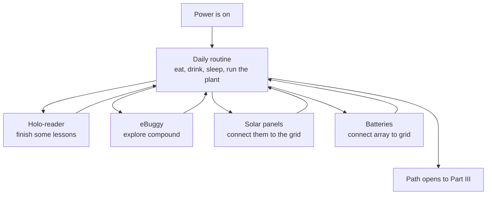

# Part II storyboard

| | |
| --- | --- |
| **Date** | 2026-11-23 |
| **Status** | Intent, not an implementation plan |
| **Picture** | [part-ii-loops.svg](part-ii-loops.svg) |

This page is what we intend the player to live through. The engineering plan beside it still describes an older shape: optional solar and batteries, and a tunnel that leads to the elevator. That plan waits until this storyboard settles.

## The shape

Power-on starts a **daily routine**. That routine is the center of Part II. Zanzibar eats, drinks, sleeps, and keeps the hydro plant running. The day repeats, and it gets busier each time he brings something new back into it.

Four accomplishments sit on that loop. He has to do all of them to some degree. None of them is a skippable side quest.

- Study on the holo-reader and finish some number of lessons.
- Ride the eBuggy inside the compound and discover the tunnel entrance.
- Discover the solar panels and connect them to the grid.
- Discover a small battery array and connect it.

Each discovery expands the operations routine. A day that began as meals, sleep, and the plant picks up reading, driving, solar, and storage.

Whenever he wants, he can leave the routine for any of the four activities and come back. Those lines do not continue onward. One line leaves the daily routine itself and ends at **Path opens to Part III**. The tunnel entrance is something he finds while driving. It is not the way in. The top of the elevator is in the utility station.

The Mermaid chart is the editable outline. The four activities stay on the links with the daily routine. The extra dash in `routine ---> part3` is what drops **Path opens to Part III** onto the next row. Nothing is drawn from the activities to that box. The SVG is the same picture.

## Still open

- How many holo-reader lessons count as enough.
- What "to some degree" means for the solar and battery connections, if a partial hookup counts.
- Where he finds the small battery array, now that it is not behind the elevator ride.
- What the tunnel entrance is for, now that it is not the way to the elevator.
